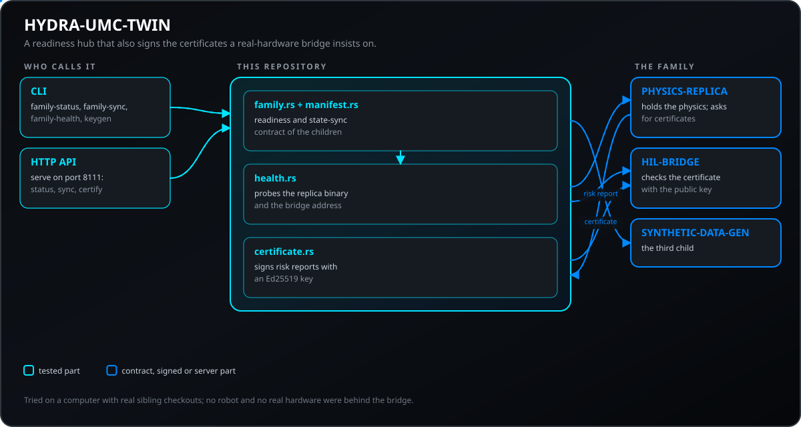
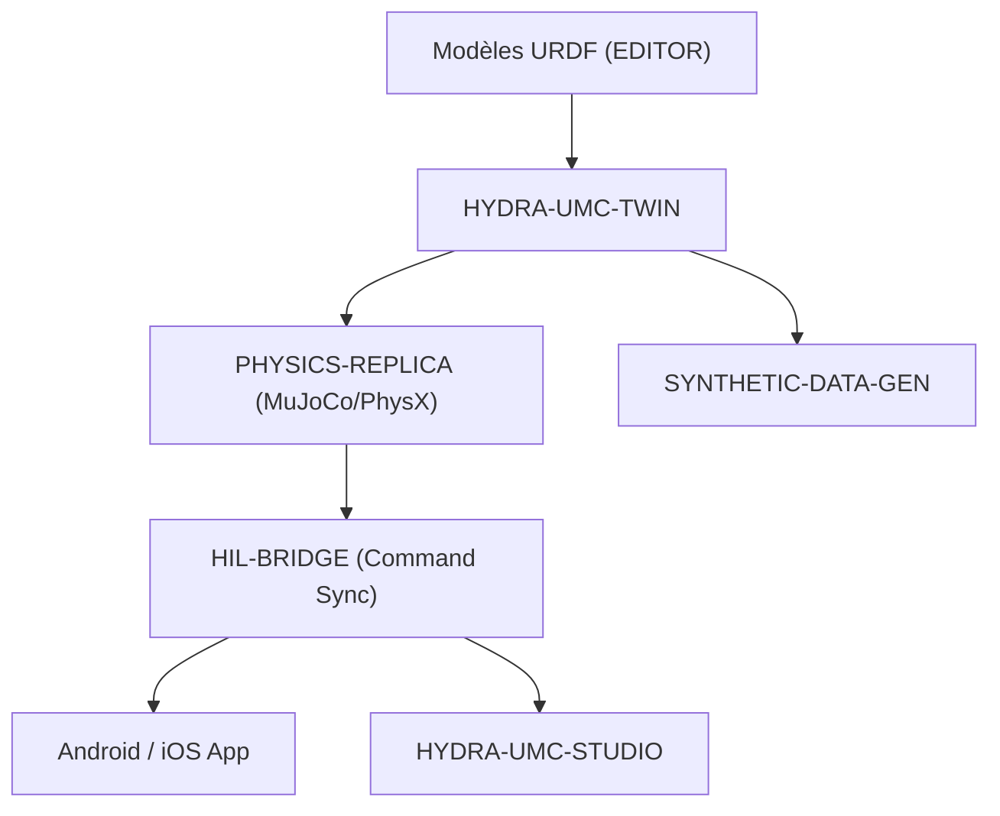
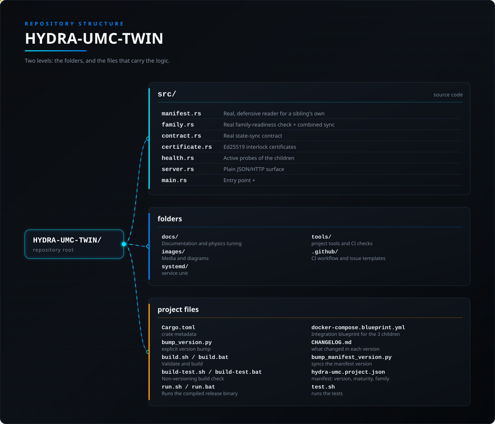

<!-- =============================================================================
HYDRA-UMC-TWIN - Digital Twin integration hub
Copyright (C) JuanenRac (Electro Hobby 3D) <electrohobby3d@gmail.com>
GPL-3.0-or-later - see LICENSE
============================================================================= -->

<p align="center">
  
</p>

# 🪞 HYDRA-UMC-TWIN

<p align="center"><a href="README.md">🇺🇸 English</a> | <a href="README_spa.md">🇪🇸 Español</a> | 🇫🇷 <b>Français</b> | <a href="README_ita.md">🇮🇹 Italiano</a> | <a href="README_deu.md">🇩🇪 Deutsch</a> | <a href="README_zho.md">🇨🇳 简体中文</a> | <a href="README_jpn.md">🇯🇵 日本語</a> | <a href="README_por.md">🇵🇹 Português</a></p>

### 🌐 Jumeau numérique basé sur la physique et moteur de simulation haute fidélité

<p align="center">
  
  
  
  
  
  
  
</p>

---

> **État de la sûreté et de la cybersécurité :** cet écosystème n'est pas un système de sécurité certifié. Il n'existe pas encore de chaîne d'E-STOP matérielle, ni de limites ou de verrouillages imposés par le firmware, ni de commande de mouvement vérifiée ; les images de firmware sont contrôlées par CRC-32 et une signature Ed25519, et une compilation de version refuse les clés de développement publiées (les têtes d'outil et les cartes d'extension derrière le relais utilisent encore les chargeurs d'URTC, qui prennent un HMAC-SHA256 à clé partagée au lieu d'une signature) ; TLS et TLS mutuel sont optionnels et désactivés par défaut ; aucune carte propre n'a encore été assemblée ni testée. Lisez la [base de sécurité](https://github.com/JuanenRac/HYDRA-UMC-DOCS/blob/main/docs/SECURITY_BASELINE.md) et le [modèle de menaces](https://github.com/JuanenRac/HYDRA-UMC-DOCS/blob/main/docs/THREAT_MODEL.md) avant de vous fier à une affirmation d'ici pour la sécurité d'une personne.

---

## 📋 En un coup d'œil

| | |
|---|---|
| Version | `0.1.2` |
| Maturité | Fonctionnel |
| Tests | 119 (`cargo test`) |
| Technologie | Rust / tiny_http |
| Cible | Le Raspberry Pi CM5 d'une cellule HYDRA-UMC |
| Sur matériel réel | Pas encore : aucune exécution sur du matériel réel n'est consignée pour cette version |

**Aller à :** [Présentation](#-présentation) · [Architecture](#-architecture) · [Sécurité et protection](#-sécurité-et-protection) · [Configuration](#-configuration) · [Démarrage rapide](#-démarrage-rapide) · [Tests](#-tests) · [Structure du dépôt](#-structure-du-dépôt) · [Projets liés](#-projets-liés)

## 🚦 État du projet

Chaque ligne est une partie de ce dépôt et le feu dit où elle en est aujourd'hui. Elle est écrite d'après ce que le dépôt peut montrer (tests, compilations, exécutions), pas d'après ce qui est prévu.

🟢 Fait et vérifié · 🟡 Fonctionne, avec des limites connues · 🟠 À moitié fait ou pas encore vérifié · 🔴 Pas fait ou ne fonctionne pas

| Domaine | État | Ce que cela veut dire ici |
|---|---|---|
| Logiciel | 🟡 | Fonctionne pour son usage principal ; la vérification d'honnêteté ci-dessus liste ce qui manque encore |
| Tests | 🟢 | 119 tests automatiques, exécutés à chaque modification |
| Matériel réel | 🔴 | Pas encore : aucune exécution sur du matériel réel n'est consignée pour cette version |
| Documentation | 🟢 | README en huit langues, vérifié par rapport au manifeste à chaque modification |

## 🎯 Présentation

**HYDRA-UMC-TWIN** est destiné à devenir le cœur virtuel de l'écosystème : une réplique basée sur la physique de la micro-usine pour tester, entraîner et surveiller des essaims robotiques en toute sécurité. Rien de tout cela n'existe encore.

Écrit en Rust, il lit aujourd'hui les manifestes de ses trois enfants (PHYSICS-REPLICA, HIL-BRIDGE, SYNTHETIC-DATA-GEN) et vérifie si chacun est prêt à se synchroniser. Le moteur physique Bevy/URDF qui émulerait inertie, frottement et couple moteur (« si cela fonctionne dans le Twin, cela fonctionne en atelier ») est prévu, pas encore implémenté.

### Caractéristiques principales :
* 🧩 **Vérification de disponibilité de la famille (v0) :** le vrai sous-commande `family-status` lit le propre `hydra-umc.project.json` de chacun des 3 vrais enfants et signale présence/version/maturité/rôle - honnête pour un hub d'intégration qui ne fait tourner encore aucun moteur lui-même. Voir « Vérification d'honnêteté » ci-dessous.
* 🔒 **Réel v0 - Contrat de synchronisation d'état :** `family-sync` filtre chaque enfant selon un contrat réel et testable - maturité minimale (`functional`) et une version majeure maximale compatible - avant de le traiter comme prêt à synchroniser, refusant un enfant immature ou à version incompatible avec une vraie raison plutôt que de synchroniser contre une forme d'état non vérifiée.
* 🔏 **Certificats d'interverrouillage :** `POST /interlock/certify` signe un rapport de risque (articulation, position, `collision_imminent`, `distance_m`) avec la clé Ed25519 du jumeau et renvoie un certificat que HYDRA-UMC-HIL-BRIDGE n'accepte que pour cette commande (récent, à usage unique) avant d'envoyer quoi que ce soit au matériel réel. La route n'existe que si le serveur démarre avec `--signing-key-file` et `--certify-token-file` (ou `HYDRA_UMC_TWIN_CERTIFY_TOKEN`) : sans le jeton personne ne peut demander de signature, sans clé la route répond `404`, et l'un sans l'autre ne démarre pas. `keygen --key-file CHEMIN` crée une clé (jamais par-dessus un fichier existant) et affiche la clé publique à donner au bridge. Tant que le moteur de physique n'existe pas, le jumeau signe le rapport de l'appelant qui détient le jeton (le réplicateur de physique), pas un rapport qu'il a calculé lui-même : un certificat vaut ce que vaut sa source. Le format est dans `docs/INTERLOCK_CERTIFICATE.md`. *(implémenté, essayé contre le vrai binaire du bridge)*
* 🔌 **API JSON HTTP (v0) :** `serve [--addr ADDR] [--port PORT] [--workspace CHEMIN]` (par défaut `127.0.0.1:8111`) expose exactement la même logique family-status/family-sync via `GET /family-status`, `GET /family-sync`, `GET /stats` par un vrai serveur `tiny_http` bloquant - le même binaire que l'unité `systemd/hydra-umc-twin.service` exécute sur une CM5 déployée (loopback uniquement). Voir [`docs/CLI_REFERENCE.md`](docs/CLI_REFERENCE.md) pour le contrat complet.
* 🩺 **Contrôle actif de la santé des enfants (v0) :** `family-health` ne croit pas les manifestes : il exécute le binaire compilé de PHYSICS-REPLICA sur un URDF de test et compare la pose à la pose exacte, et appelle `GET /stats` du pont HIL en marche (`--physics-replica-bin`, `--hil-bridge-addr`, `--timeout-ms`). Un enfant qu'on ne peut ni exécuter ni joindre, ou qui répond mal, est signalé comme tel ; SYNTHETIC-DATA-GEN n'a rien à exécuter et est signalé comme non sondé. `serve --health-probes` ajoute `GET /family-health` (désactivé par défaut, réponses mises en cache, la requête ne choisit jamais ce qui s'exécute). *(implémenté)*
* 🚧 **Prédiction de collision (désactivée par défaut) :** avec `serve --collision-predict`, `POST /predict/collision` répond si une courte liste d'états futurs des articulations devrait entrer dans une zone du fichier de zones ou toucher le robot lui-même, en interrogeant HYDRA-UMC-PHYSICS-REPLICA (qui surestime par construction). Les articulations qu'un état omet viennent des derniers rapports des articulations réelles, et une articulation que personne ne connaît est une erreur, jamais zéro. C'est une simple information : les certificats et `/interlock/*` ne la lisent pas, et un échec n'est jamais lu comme « libre ». Non essayé avec un robot réel. Voir `docs/COLLISION_PREDICTION.md`.
* 🌐 **Simulation complète de l'usine (prévu) :** réplique les robots, les outils et l'environnement dans un espace 3D unifié - dépend qu'une véritable intégration du moteur Bevy existe d'abord.
* ⚡ **Hardware-in-the-Loop (HIL) (prévu) :** connectez les applications et les studios au simulateur comme s'il s'agissait d'un contrôleur réel.
* 📊 **Prédiction de l'usure (prévu) :** estime la durée de vie des composants en fonction des contraintes mécaniques simulées.
* 🛡️ **Validation de la sécurité (prévu) :** testez des trajectoires complexes et l'évitement de collision avant l'exécution physique.

**Vérification d'honnêteté - ce qui fonctionne réellement aujourd'hui :** l'appel sans argument affiche toujours identité/version/rôle, mais il existe désormais trois vrais sous-commandes. `family-status [--workspace CHEMIN]` lit les vrais manifestes propres de `HYDRA-UMC-PHYSICS-REPLICA`/`HYDRA-UMC-HIL-BRIDGE`/`HYDRA-UMC-SYNTHETIC-DATA-GEN` depuis un checkout local et signale honnêtement ce qu'il trouve. `family-sync [--workspace CHEMIN]` va plus loin : il fait passer chaque enfant présent par un vrai contrat de synchronisation d'état (maturité minimale `functional`, version majeure maximale compatible) et rapporte `READY`, `REJECTED (immature)`, `REJECTED (incompatible version)` ou `MISSING` par enfant. `serve` expose les deux via de vraies API HTTP JSON au lieu d'invocations CLI ponctuelles. Aucune application Bevy, aucun rendu, aucune boucle physique, aucun chargement de scène URDF, ni aucun vrai transport de synchronisation réseau n'existe encore - voir [`CHANGELOG.md`](CHANGELOG.md) pour ce qui a été livré exactement, [`docs/CLI_REFERENCE.md`](docs/CLI_REFERENCE.md) pour chaque commande/point de terminaison, et la Roadmap ci-dessous pour ce qui reste à venir.

## 🧩 Rôle dans HYDRA-UMC

**HYDRA-UMC-TWIN** est le parent d'intégration de la famille Digital Twin. Il lit les manifestes de ses trois enfants, indique si la famille est prête et en phase, sonde leur santé et signe des certificats d'interverrouillage qui disent au pont hardware-in-the-loop qu'un rapport de risque vient du jumeau. Le moteur physique lui-même reste prévu.

## 🏛️ Architecture

<p align="center">
  
</p>

<details>
<summary>Version texte du diagramme (Mermaid)</summary>



</details>

### ARCHITECTURE & DÉCISIONS DE CONCEPTION

* **Pourquoi ce moteur n'a pas de dossiers `hardware/`/`firmware/`/`os/`.** Logiciel pur sans carte propre; les dossiers source ne sont inclus que lorsque leur implémentation les requiert.
* **Pourquoi `Cargo.toml` n'a délibérément pas encore de dépendance Bevy.** Bevy est un moteur graphique lourd - temps de compilation longs, nécessite une chaîne d'outils GPU/graphique pas toujours disponible. v0 n'a ajouté que `serde`/`serde_json`/`tiny_http` (pour lire les manifestes des enfants) - le vrai travail de rendu attend toujours qu'une vraie chaîne d'outils GPU/graphique existe pour compiler contre.
* **Pourquoi `docker-compose.blueprint.yml` existe avant que ses 3 enfants n'aient de Dockerfile.** Décider et documenter le contrat d'intégration (quel service dépend de lequel, quels montages device/volume chacun nécessite) maintenant évite que cette forme soit inventée à l'improviste plus tard, même si `docker compose up` ne peut pas pleinement réussir tant que chaque enfant n'a pas publié son propre Dockerfile.
* **Comment cela s'intègre dans le reste de l'écosystème.** Le parent d'intégration de la famille Jumeau Numérique et Simulation - HYDRA-UMC-PHYSICS-REPLICA lui apporte un vrai solveur physique, HYDRA-UMC-HIL-BRIDGE permet à de vraies applications de le contrôler comme s'il s'agissait de matériel, et HYDRA-UMC-SYNTHETIC-DATA-GEN rend des jeux de données d'entraînement via son propre moteur.
* **Pourquoi `family-status` lit le propre manifeste de chaque enfant plutôt qu'une liste tenue à la main.** `hydra-umc.project.json` est déjà la seule source de vérité en laquelle le dashboard/updater de l'écosystème ont confiance - une seconde liste ici se désynchroniserait dès qu'une vraie maturité d'un enfant changerait sans que personne ne pense à la mettre à jour.
* **Pourquoi un checkout frère absent est un vrai « introuvable » honnête plutôt qu'un plantage.** Un hub d'intégration ne peut réellement pas savoir si un développeur a bien les 3 enfants clonés localement - `manifest.rs` retourne `None` pour chaque vrai mode d'échec (dépôt absent, fichier absent, JSON malformé) afin que `family-status` puisse le signaler clairement plutôt que de paniquer.
* **Pourquoi `family-sync` filtre à la fois sur la maturité ET un plafond de version, pas seulement sur « est-il présent ».** `family-status` répond déjà à « cet enfant est-il cloné et que prétend-il de lui-même » - mais un enfant cloné de maturité `scaffolding` n'a pas encore de vrai état qui vaille la peine d'être synchronisé, et un enfant qui a dépassé la version majeure maximale vérifiée par ce Jumeau a pu changer sa propre forme d'état d'une manière que ce Jumeau ignore. Les deux sont de vraies raisons de refuser la synchronisation, distinctes de « absent », donc `contract.rs` les vérifie et les rapporte séparément plutôt que de tout fondre dans un « pas prêt » générique.
* **Pourquoi la maturité est vérifiée avant la compatibilité de version dans `contract::assess()`.** Le numéro de version d'un enfant immature n'est pas encore un signal significatif - vérifier la maturité en premier signifie que la raison de rejet rapportée nomme toujours la porte la plus fondamentale qui a réellement échoué, plutôt qu'une incompatibilité de version masquant un problème plus basique de « cet enfant n'est pas encore réel ».

**Contrats vérifiés avec JSON Schema.** `validate-state FICHIER` vérifie un état du jumeau (le contrat `TwinState` du SDK : états des articulations, poses nommées, instant, repère et indication `real` ou `simulated`) contre son schéma, et refuse un quaternion de pose de longueur différente de 1 ainsi qu'une articulation nommée deux fois. Le manifeste d'un enfant qui déclare `schema_version` est validé contre le schéma de manifeste de projet du SDK avec la crate `jsonschema` (Draft 2020-12, formats vérifiés) ; les deux schémas sont embarqués dans `schemas/`.

## 🔒 Sécurité et protection

| Menace | Défense | Où |
|---|---|---|
| Un rapport de risque écrit par celui qui veut faire bouger le robot | Le rapport voyage comme un certificat signé avec la clé Ed25519 du jumeau ; le pont n'a que la moitié publique, donc personne qui l'atteint ne peut en fabriquer un | `src/certificate.rs`, `docs/INTERLOCK_CERTIFICATE.md` |
| N'importe qui demandant au jumeau de signer | `POST /interlock/certify` n'existe que si le jumeau démarre avec une clé de signature et un jeton de certification ; son corps est limité à 4 KiB et `keygen` n'écrase jamais un fichier et l'écrit en mode 0600 sous Unix | `src/server.rs`, `src/main.rs` |

**Ce qu'il ne fait jamais :** simuler la physique, pas encore. Tant que le moteur n'existe pas, le jumeau signe le rapport de l'appelant qui détient le jeton de certification ; un certificat vaut donc ce que vaut la source du rapport.

Le paramètre `?workspace=` de l'API HTTP est limité par défaut à l'espace de travail servi, de sorte qu'une requête ne puisse pas faire explorer à l'API d'autres répertoires de la machine ; `--strict-workspace-root CHEMIN` choisit une autre racine et `--allow-any-workspace` rétablit l'ancien comportement, sans limite.

## ⚙️ Configuration

| Variable | Par défaut | Ce qu'elle définit |
|---|---|---|
| `--addr` | `127.0.0.1` | adresse de l'API HTTP |
| `--port` | `8111` | port de l'API HTTP |
| `--workspace` | le dossier qui contient ce dépôt | où l'on cherche les dépôts frères |
| `--physics-replica-bin` / `HYDRA_UMC_TWIN_PHYSICS_REPLICA_BIN` | aucun | binaire de la réplique physique que lance la vérification de santé |
| `--hil-bridge-addr` / `HYDRA_UMC_TWIN_HIL_ADDR` | aucun | hôte:port du pont hardware-in-the-loop sondé |
| `--timeout-ms` | `5000` | temps accordé à chaque sonde de santé |
| `--signing-key-file` / `HYDRA_UMC_TWIN_SIGNING_KEY_FILE` | aucun | clé Ed25519 qui active la signature de certificats |
| `--certify-token-file` / `HYDRA_UMC_TWIN_CERTIFY_TOKEN` | aucun | jeton exigé par `POST /interlock/certify` |

## 🚀 Démarrage rapide

Nécessite la chaîne d'outils Rust stable (édition 2021) avec `cargo`.

```bash
./build.sh  # Linux, macOS (build.bat on Windows)
./run.sh family-status
./run.sh family-sync
./run.sh serve --port 8111
./run.sh keygen --key-file twin.key
```

## 🧪 Tests

119 tests automatiques s'exécutent avec `cargo test`. Ils n'ont besoin ni de matériel ni de rien en dehors de cette machine.

La CI exécute `HYDRA_UMC_CI=1 python tools/ci_validate.py`, qui vérifie le manifeste, les documents, les huit README et les images.

## 🏗️ Compilation et publication

Nécessite la chaîne d'outils Rust (`cargo`/`rustc`, à installer via [rustup](https://rustup.rs)) et Python 3.10+ (uniquement pour `bump_version.py`).

```bash
# Linux / macOS
./build.sh   # `cargo test` (119 tests), puis `cargo build --release`
./run.sh     # exécute target/release/hydra-umc-twin, affiche nom + version + rôle
```

```bat
:: Windows
build.bat
run.bat
```

`build.sh`/`build.bat` ne changent jamais la version (seule `python tools/hydra_project_tool.py bump` la fait monter), exécutent la vraie suite de tests, puis construisent un binaire release.

Le vrai sous-commande `family-status` vérifie le vrai checkout local :

```bash
./run.sh family-status
./run.sh family-status --workspace /chemin/vers/un/autre/checkout

# Windows
run.bat family-status
```

```text
Digital Twin family status (workspace: /chemin/vers/GitHub):
  HYDRA-UMC-PHYSICS-REPLICA: v0.0.6, maturity=established, role=library
  HYDRA-UMC-HIL-BRIDGE: v0.0.8, maturity=established, role=service
  HYDRA-UMC-SYNTHETIC-DATA-GEN: v0.0.9, maturity=established, role=tool

All 3 children present.
```

Par défaut, utilise le propre dossier parent de ce dépôt - la vraie disposition de checkout-frère que cet écosystème utilise déjà. Se termine avec `1` si un vrai enfant manque.

Le vrai sous-commande `family-sync` va plus loin - il vérifie aussi le vrai contrat de synchronisation d'état (maturité minimale, version majeure maximale compatible) pour chaque enfant présent :

```bash
./run.sh family-sync --workspace /chemin/vers/un/checkout
```

```text
Digital Twin family sync contract (workspace: /chemin/vers/un/checkout):
  HYDRA-UMC-PHYSICS-REPLICA: READY (v0.0.6, maturity=functional)
  HYDRA-UMC-HIL-BRIDGE: REJECTED (incompatible version) - HYDRA-UMC-HIL-BRIDGE reports major version 1 - this Twin's sync contract is only verified up to major 0 (incompatible simulator version)
  HYDRA-UMC-SYNTHETIC-DATA-GEN: MISSING (not checked out)

Not every child is sync-ready - see the lines above.
```

Se termine avec `0` seulement si chaque enfant attendu est `READY` ; `1` pour tout enfant `MISSING`/`REJECTED`.

**Important :** `Cargo.toml` n'a délibérément **pas encore la dépendance Bevy**. Bevy est un moteur graphique lourd (temps de compilation longs, nécessite une chaîne d'outils GPU/graphique pas toujours disponible) ; v0 n'a ajouté que `serde`/`serde_json`/`tiny_http` pour lire les manifestes. La vraie dépendance `bevy` (plus un backend physique et le client gRPC/WebSocket pour HIL-BRIDGE) sera ajoutée quand le vrai travail de rendu/moteur commencera.

### Intégration des 3 enfants (`docker-compose.blueprint.yml`)

En tant que parent d'intégration, `docker-compose.blueprint.yml` documente comment ce moteur compose ses 3 enfants en une seule stack : **PHYSICS-REPLICA** (solveur, appelé à chaque tick physique), **HIL-BRIDGE** (synchronisation des commandes réel vs virtuel) et **SYNTHETIC-DATA-GEN** (export de jeux de données par lot, hors ligne). Aucun des 4 projets n'a encore de `Dockerfile` à ce stade de squelette, donc `docker compose up` n'est pas exécutable aujourd'hui; le fichier est la référence confirmée de topologie, ports et dépendances des futurs Dockerfiles.

## 📂 Structure du dépôt

<p align="center">
  
</p>

<details>
<summary>Version texte de l'arborescence</summary>

```text
HYDRA-UMC-TWIN/
├── src/                             code source
│   ├── manifest.rs                  Lecteur réel et défensif du manifeste propre d'un frère
│   ├── family.rs                    Vraie vérification de disponibilité + résultat de sync combiné
│   ├── contract.rs                  Vrai contrat de sync d'état (maturité + plafond de version)
│   ├── certificate.rs               Certificats d'interverrouillage Ed25519 : le texte signé, la signature, les nonces, la génération de clés
│   ├── health.rs                    Sondes actives des enfants : lance le binaire de PHYSICS-REPLICA, appelle le pont HIL
│   ├── collision.rs                 Prédiction de collision (`POST /predict/collision`, désactivée par défaut) : interroge PHYSICS-REPLICA, information seule
│   ├── server.rs                    Surface JSON/HTTP simple (tiny_http, bloquant, sans runtime async)
│   └── main.rs                      Point d'entrée + vrais sous-commandes `family-status`/`family-sync`
├── schemas/                         schémas JSON des contrats du SDK embarqués
├── docs/                            Documentation et réglage physique
├── images/                          Médias et diagrammes
├── systemd/                         unité de service
├── tests/                           cli_modes.rs : les contrôles de la famille, la validation d'état, les refus de démarrage de serve et la génération de clés vus par l'appelant
├── tools/                           outils du projet et vérifications de la CI
├── .github/                         workflow de CI et modèles de tickets
├── Cargo.toml                       Métadonnées du paquet, dépendances (serde/serde_json), version compteur kilométrique
├── bump_version.py                  Incrément de version type compteur kilométrique (exécuté seulement par la commande `bump` explicite)
├── build.sh / build.bat             Valide et compile (compiler ne change jamais la version)
├── build-test.sh / build-test.bat   Vérification de build sans versionnage
├── run.sh / run.bat                 Exécute le binaire release compilé (relaie les arguments)
├── docker-compose.blueprint.yml     Plan d'intégration des 3 enfants ci-dessous
├── CHANGELOG.md                     ce qui a changé à chaque version
├── bump_manifest_version.py         synchronise la version du manifeste
├── hydra-umc.project.json           manifeste : version, maturité, famille
└── test.sh                          lance les tests
```

</details>

## 🗺️ Feuille de route et limites connues

**Limites connues aujourd'hui**

* **Phase 1 :** Synchronisation du jumeau numérique avec la télémétrie matérielle en temps réel et latence inférieure à 10 ms.
* **Phase 2 :** Intégration de Physics Replica avec des simulateurs de classe industrielle (Isaac Sim) et prise en charge des corps déformables.
* **Phase 3 :** Modèles de récupération automatisés de Node Healing pour un basculement décentralisé et détection précoce de la dégradation des capteurs.
* **Phase 4 :** Rendu photoréaliste pour la génération de données synthétiques et prise en charge de HIL Bridge pour le véhicule en boucle à grande échelle.

## 🌍 Langues

Ce README et les documents du dépôt existent en huit langues : anglais, espagnol, allemand, français, italien, japonais, chinois et portugais (Portugal). Ils sont écrits ensemble et la CI vérifie que les huit fichiers ont les mêmes sections et les mêmes liens. Ce dépôt n'a ni écran ni catalogue de messages propre, il n'y a donc aucune chaîne d'interface à traduire.

## 🔗 Projets liés

Ce projet fait partie de l'écosystème robotique HYDRA-UMC du même auteur (JuanenRac / Electro Hobby 3D). Bon à savoir, car une demande pourrait en réalité concerner l'un de ceux-ci plutôt que ce dépôt.

**Projets Enfants** — chacun se branche sur le propre moteur de simulation/rendu de ce jumeau
- **[HYDRA-UMC-PHYSICS-REPLICA](https://github.com/JuanenRac/HYDRA-UMC-PHYSICS-REPLICA)** — vraie cinématique directe et validation des limites articulaires sur un vrai sous-ensemble URDF.
- **[HYDRA-UMC-HIL-BRIDGE](https://github.com/JuanenRac/HYDRA-UMC-HIL-BRIDGE)** — routeur hardware-in-the-loop avec un verrouillage logiciel de collision entre simulation et matériel réel (testé sans matériel réel).
- **[HYDRA-UMC-SYNTHETIC-DATA-GEN](https://github.com/JuanenRac/HYDRA-UMC-SYNTHETIC-DATA-GEN)** — vrai générateur procédural de scènes 2D avec export d'annotations YOLO/COCO.

**Directement Liés**
- **[HYDRA-UMC-EDITOR-URDF](https://github.com/JuanenRac/HYDRA-UMC-EDITOR-URDF)** — créateur/éditeur graphique de bureau pour URDF qui envoie les modèles terminés vers le propre catalogue de STUDIO ; l'outil avec lequel sont créés les modèles URDF que consomme ce jumeau.
- **[HYDRA-UMC-EDITOR-STL](https://github.com/JuanenRac/HYDRA-UMC-EDITOR-STL)** — éditeur de bureau de modèles STL, transformant/remplaçant/retirant/ajoutant de vraies pièces dans le même catalogue de modèles qu'édite aussi HYDRA-UMC-EDITOR-URDF.
- **[HYDRA-UMC-SUITE](https://github.com/JuanenRac/HYDRA-UMC-SUITE)** — centre de commande d'essaim de bureau (PySide6) pour plusieurs serveurs à la fois, empaqueté en exécutable autonome ; est destinée à contrôler ce jumeau comme s'il s'agissait de matériel réel, via HIL-BRIDGE (prévu).
- **[HYDRA-UMC-ANDROID-CONTROL](https://github.com/JuanenRac/HYDRA-UMC-ANDROID-CONTROL)** — application de contrôle Android native avec connexion biométrique et un compagnon Wear OS jumelé ; est destinée à contrôler ce jumeau comme s'il s'agissait de matériel réel, via HIL-BRIDGE (prévu).
- **[HYDRA-UMC-IOS-CONTROL](https://github.com/JuanenRac/HYDRA-UMC-IOS-CONTROL)** — application de contrôle iOS/iPadOS (Flutter) avec synchronisation WebSocket en temps réel ; est destinée à contrôler ce jumeau comme s'il s'agissait de matériel réel, via HIL-BRIDGE (prévu).

**Fait Également Partie de l'Écosystème**

*Matériel & Plateforme de Base*
- **[HYDRA-UMC](https://github.com/JuanenRac/HYDRA-UMC)** — la conception de la carte mère du bras robotique : hôte CM5 + coprocesseur STM32H745 double cœur, destinée à coordonner jusqu'à 8 bras-outils via CAN-OTA/SPI-OTA (firmware à un stade précoce ; aucune carte assemblée pour l'instant).
- **[HYDRA-UMC-OS](https://github.com/JuanenRac/HYDRA-UMC-OS)** — couche produit reproductible sur Raspberry Pi OS pour le CM5 : agent en lecture seule, config/profils validés, provisionnement WiFi de premier contact.
- **[HYDRA-UMC-SDK](https://github.com/JuanenRac/HYDRA-UMC-SDK)** — le contrat JSON-Schema partagé et la barrière logicielle de contrôle des jobs contre laquelle chaque bridge valide ses commandes (pas une fonction de sécurité certifiée).
- **[HYDRA-UMC-CONNECTOR-HUB](https://github.com/JuanenRac/HYDRA-UMC-CONNECTOR-HUB)** — registre déclaratif et validateur de manifestes d'adaptateur pour les connecteurs de machines externes ; étend la propre idée de contrat du SDK aux machines externes sans remplacer les projets de passerelle industrielle.

*Backend Central & Clients*
- **[HYDRA-UMC-SERVER](https://github.com/JuanenRac/HYDRA-UMC-SERVER)** — le vrai backend headless (REST/WebSocket) auquel parle réellement chaque client de contrôle.
- **[HYDRA-UMC-STUDIO](https://github.com/JuanenRac/HYDRA-UMC-STUDIO)** — tableau de bord de contrôle web avec visualisation 3D multi-robot en temps réel.
- **[HYDRA-UMC-DSI](https://github.com/JuanenRac/HYDRA-UMC-DSI)** — interface tactile native pour l'écran tactile DSI 7" embarqué, intégrée directement sur le CM5.
- **[HYDRA-UMC-BRIDGE-AMR](https://github.com/JuanenRac/HYDRA-UMC-BRIDGE-AMR)** — frontière de coordination pour les flottes AGV/AMR via un éditeur MQTT VDA 5050 (testé uniquement contre une flotte émulée).
- **[HYDRA-UMC-BRIDGE-CNC](https://github.com/JuanenRac/HYDRA-UMC-BRIDGE-CNC)** — coordinateur haut niveau pour cellules CNC avec accès au statut/octets de contrôle GRBL (testé uniquement contre un émulateur).
- **[HYDRA-UMC-BRIDGE-DROIDS](https://github.com/JuanenRac/HYDRA-UMC-BRIDGE-DROIDS)** — frontière de coordination pour droïdes à pattes/humanoïdes, avec un émetteur de commandes Boston Dynamics Spot (testé uniquement contre un émulateur).
- **[HYDRA-UMC-BRIDGE-LASER](https://github.com/JuanenRac/HYDRA-UMC-BRIDGE-LASER)** — coordinateur de cellules laser lisant 3 signaux GPIO de clé/enceinte/verrouillage (testé uniquement contre une puce simulée ; il ne peut ni armer ni tirer un laser).
- **[HYDRA-UMC-BRIDGE-OPENPNP](https://github.com/JuanenRac/HYDRA-UMC-BRIDGE-OPENPNP)** — coordinateur haut niveau sûr pour le flux de cartes du pick-and-place OpenPnP.
- **[HYDRA-UMC-BRIDGE-PRINTER3D](https://github.com/JuanenRac/HYDRA-UMC-BRIDGE-PRINTER3D)** — frontière de coordination sûre pour imprimantes 3D Moonraker/Klipper, avec de vraies commandes de tâche contrôlées.
- **[HYDRA-UMC-BRIDGE-ROS2](https://github.com/JuanenRac/HYDRA-UMC-BRIDGE-ROS2)** — coordinateur avec un transport ROS 2 rclpy à importation paresseuse (pas encore exécuté contre une installation ROS 2).
- **[HYDRA-UMC-BRIDGE-UAV](https://github.com/JuanenRac/HYDRA-UMC-BRIDGE-UAV)** — frontière de coordination pour UAV équipés de caméra, avec un émetteur de commandes MAVLink (testé uniquement contre un émulateur).

*Plateforme d'Outils URTC*
- **[URTC](https://github.com/JuanenRac/URTC)** — firmware pour la carte physique Universal Robot Tool Controller, plus de 25 profils d'outil sur bus CAN.
- **[URTC-FLASHER](https://github.com/JuanenRac/URTC-FLASHER)** — outil de bureau à interface graphique pour flasher les cartes URTC, CAN-OTA plus SWD/JTAG puce complète.
- **[URTC-TESTER](https://github.com/JuanenRac/URTC-TESTER)** — outil de bureau de diagnostic CAN-bus en direct pour cartes URTC, un panneau par profil d'outil.
- **[URTC-WEB-STUDIO](https://github.com/JuanenRac/URTC-WEB-STUDIO)** — alternative basée navigateur à URTC-TESTER via la Web Serial API, sans installation locale.
- **[URTC-GATEWAY](https://github.com/JuanenRac/URTC-GATEWAY)** — passerelle devant le bus CAN d'URTC : liste d'identifiants autorisés, limite de débit et clé de session ; logiciel testé sur ordinateur, pas encore sur un bus réel.

*Nœud IA de Vision (Hailo-8)*
- **[HYDRA-UMC-VISION-NODE](https://github.com/JuanenRac/HYDRA-UMC-VISION-NODE)** — hub d'intégration pour le pipeline de vision Hailo-8, avec une vraie vérification de disponibilité matérielle par étape.
- **[HYDRA-UMC-DETECTION-HEF](https://github.com/JuanenRac/HYDRA-UMC-DETECTION-HEF)** — registre réel de modèles compilés avec vérification de chargement sécurisé par architecture Hailo/checksum.
- **[HYDRA-UMC-VISION-STREAMER](https://github.com/JuanenRac/HYDRA-UMC-VISION-STREAMER)** — générateur réel de pipeline GStreamer + config MediaMTX, avec une vraie frontière d'intégration HailoRT.
- **[HYDRA-UMC-VISUAL-SERVOING-API](https://github.com/JuanenRac/HYDRA-UMC-VISUAL-SERVOING-API)** — loi de correction Position-Based Visual Servoing avec autorisation conditionnée à l'état de zone ; pas encore d'estimation de pose par caméra.
- **[HYDRA-UMC-SAFETY-ZONES](https://github.com/JuanenRac/HYDRA-UMC-SAFETY-ZONES)** — logique v0 de violation de zone, de fraîcheur de calibration et de demande d'E-STOP qui lit les positions d'objets dans un fichier ; aucun détecteur ne l'alimente et aucun E-STOP physique n'y est encore relié.

*Nœud IA Cognitif (Hailo-10)*
- **[HYDRA-UMC-COGNITIVE-NODE](https://github.com/JuanenRac/HYDRA-UMC-COGNITIVE-NODE)** — hub d'intégration pour le pipeline cognitif Hailo-10 (orchestration LLM/VLA/voix).
- **[HYDRA-UMC-VLA-ENGINE](https://github.com/JuanenRac/HYDRA-UMC-VLA-ENGINE)** — vrai encodage/décodage de jetons d'action et génération de trajectoire pour un modèle Vision-Language-Action.
- **[HYDRA-UMC-VOICE-UI](https://github.com/JuanenRac/HYDRA-UMC-VOICE-UI)** — vrai front-end vocal (VAD + analyseur d'intention) avec un relais Watch borné et soumis à confirmation.
- **[HYDRA-UMC-SEMANTIC-PLANNER](https://github.com/JuanenRac/HYDRA-UMC-SEMANTIC-PLANNER)** — vraie décomposition de tâches basée sur des règles et récupération sémantique d'erreurs sur les codes d'erreur MCU.
- **[HYDRA-UMC-DOCS-QA](https://github.com/JuanenRac/HYDRA-UMC-DOCS-QA)** — vraie recherche documentaire TF-IDF (bibliothèque standard uniquement) sur les propres documents Markdown de cet écosystème.
- **[HYDRA-UMC-LOCAL-TECHNICIAN](https://github.com/JuanenRac/HYDRA-UMC-LOCAL-TECHNICIAN)** — technicien de maintenance IA local et à portes de politique pour l'écosystème lui-même - observe, diagnostique et propose des corrections ; les deux niveaux de risque les plus élevés ne sont délibérément pas encore implémentés.

*Orchestration & Essaim*
- **[HYDRA-UMC-ORCHESTRATOR](https://github.com/JuanenRac/HYDRA-UMC-ORCHESTRATOR)** — hub d'intégration avec un vrai contrat de rapport de santé gRPC/Protobuf et une machine à états de mission.
- **[HYDRA-UMC-JOB-DISPATCHER](https://github.com/JuanenRac/HYDRA-UMC-JOB-DISPATCHER)** — vraie file de tâches basée sur la priorité avec déduplication, via une vraie API HTTP.
- **[HYDRA-UMC-NODE-HEALING](https://github.com/JuanenRac/HYDRA-UMC-NODE-HEALING)** — vrai chien de garde de santé de flotte basé sur gRPC, avec retry/backoff et détection d'incohérence d'identité.
- **[HYDRA-UMC-PATH-PLANNER-3D](https://github.com/JuanenRac/HYDRA-UMC-PATH-PLANNER-3D)** — vrai planificateur de trajectoire 3D basé sur RRT, avec vraie validation des collisions obstacle/espace de travail.
- **[HYDRA-UMC-SWARM-SYNC](https://github.com/JuanenRac/HYDRA-UMC-SWARM-SYNC)** — vraie synchronisation d'état CRDT LWW-Element-Map, testée par propriétés pour la convergence multi-cellule.

*Données & Analytique*
- **[HYDRA-UMC-DATALAKE](https://github.com/JuanenRac/HYDRA-UMC-DATALAKE)** — vrai magasin de séries temporelles basé sur sqlite3, avec une vraie API HTTP d'ingestion/requête.
- **[HYDRA-UMC-ANOMALY-DETECTOR](https://github.com/JuanenRac/HYDRA-UMC-ANOMALY-DETECTOR)** — vrai détecteur d'anomalies FFT + ligne de base statistique, avec surveillance de dérive.
- **[HYDRA-UMC-PRODUCTION-REPORTS](https://github.com/JuanenRac/HYDRA-UMC-PRODUCTION-REPORTS)** — vrai calcul OEE/disponibilité sur l'historique de DATALAKE, avec export CSV reproductible.
- **[HYDRA-UMC-TELEMETRY-COLLECTOR](https://github.com/JuanenRac/HYDRA-UMC-TELEMETRY-COLLECTOR)** — vrai pipeline d'ingestion CAN/WebSocket vers DATALAKE, avec déduplication par séquence.

*Passerelle Industrielle*
- **[HYDRA-UMC-GATEWAY-INDUSTRIAL](https://github.com/JuanenRac/HYDRA-UMC-GATEWAY-INDUSTRIAL)** — hub d'intégration relayant vers les protocoles industriels, avec une vraie couche de liste blanche de commandes/contre-pression.
- **[HYDRA-UMC-OPCUA-SERVER](https://github.com/JuanenRac/HYDRA-UMC-OPCUA-SERVER)** — vrai espace d'adressage OPC-UA, vérifié avec une vraie session client du protocole binaire.
- **[HYDRA-UMC-MQTT-BROKER](https://github.com/JuanenRac/HYDRA-UMC-MQTT-BROKER)** — vrai broker MQTT avec authentification par client optionnelle et ACL de sujets.
- **[HYDRA-UMC-MTCONNECT-ADAPTER](https://github.com/JuanenRac/HYDRA-UMC-MTCONNECT-ADAPTER)** — vrais points de terminaison XML MTConnect `/probe` et `/current`, avec sortie en mode dégradé.

*Outils Complémentaires & Opérations de l'Écosystème*
- **[HYDRA-UMC-DASHBOARD-AI](https://github.com/JuanenRac/HYDRA-UMC-DASHBOARD-AI)** — panneaux Smart Summaries et Anomaly Highlighting sur DATALAKE/ANOMALY-DETECTOR, avec un repli statistique honnête.
- **[HYDRA-UMC-TOOL-CLI](https://github.com/JuanenRac/HYDRA-UMC-TOOL-CLI)** — CLI de flotte avec un vrai contrat de codes de sortie stable, un vrai client en direct de la propre API de HYDRA-UMC-SERVER.
- **[HYDRA-UMC-WATCH](https://github.com/JuanenRac/HYDRA-UMC-WATCH)** — application compagnon WearOS avec des motifs d'alerte haptique et un relais vocal vers le téléphone jumelé (pas encore exécutée sur une montre physique).
- **[URTC-SMART-RACK](https://github.com/JuanenRac/URTC-SMART-RACK)** — firmware pour un rack de montage de cartes avec décodage réel d'ID d'outil et logique de préchauffage Smart Idle.
- **[URTC-VISION-TOOL](https://github.com/JuanenRac/URTC-VISION-TOOL)** — firmware plus un vrai compagnon de vision Python pour une tête d'outil d'inspection thermique/RGB.
- **[HYDRA-UMC-UPDATER](https://github.com/JuanenRac/HYDRA-UMC-UPDATER)** — outil administratif de bureau qui découvre, clone et met à jour chaque dépôt de cet écosystème.
- **[HYDRA-UMC-OS-REBUILDER](https://github.com/JuanenRac/HYDRA-UMC-OS-REBUILDER)** — outil de bureau Windows/Linux qui construit une image de la CM5 prête à graver, préchargée avec les versions les plus actuelles de l'écosystème, avec une configuration de premier démarrage Wi-Fi/utilisateur/SSH façon Raspberry Pi Imager.
- **[HYDRA-UMC-OPS-AGENT](https://github.com/JuanenRac/HYDRA-UMC-OPS-AGENT)** — coordinateur d'incidents de maintenance : un rôle edge à faible privilège collecte un instantané d'inventaire/santé assaini, un rôle control-plane le rend en lecture seule et demande à un fournisseur d'IA de suggérer un diagnostic - n'applique jamais de correctif ni ne déploie rien.
- **[HYDRA-UMC-DEV-SERVER](https://github.com/JuanenRac/HYDRA-UMC-DEV-SERVER)** — hôte de développement reproductible (Raspberry Pi 5 / CM5) qui héberge le code source de l'écosystème et exécute des tâches de compilation/test délimitées via une file d'attente durable ; un rôle de développement dédié, explicitement distinct d'un CM5 opérationnel.

## 📚 Documentation

Où lire la suite :

* **[docs/CLI_REFERENCE.md](docs/CLI_REFERENCE.md)** — chaque invocation de `family-status`/`family-sync`/`serve`, sortie réelle capturée depuis un binaire de release compilé, la table des codes de sortie, et le contrat HTTP JSON `GET /family-status`/`GET /family-sync`/`GET /stats`.
* **[docs/COLLISION_PREDICTION.md](docs/COLLISION_PREDICTION.md)** — la route de prédiction de collision : les interrupteurs, la requête et la réponse, les codes d'état et les limites.
* [Base de sécurité de l'écosystème](https://github.com/JuanenRac/HYDRA-UMC-DOCS/blob/main/docs/SECURITY_BASELINE.md)
* [Modèle de menaces de l'écosystème](https://github.com/JuanenRac/HYDRA-UMC-DOCS/blob/main/docs/THREAT_MODEL.md)
* [Journal des modifications de ce dépôt](CHANGELOG.md)
* [Licence de ce dépôt](LICENSE.md)

## 🤝 Contribuer et communauté

* Avant une pull request, exécutez `HYDRA_UMC_CI=1 py -3 tools/ci_validate.py` (ou `HYDRA_UMC_CI=1 python3 tools/ci_validate.py`) : il doit afficher `CI_VALIDATION=PASS`. N'exécutez pas `build.sh` ni `build.bat` pour cette vérification ; compiler n'est pas vérifier.
* Les huit README sont écrits à partir d'une source unique dans HYDRA-UMC-DOCS ; ne les modifiez pas à la main. Changez la source et réécrivez-les avec `tools/make_readmes.py`.
* N'affirmez pas dans un README ce qui n'a pas tourné : écrivez « simulé » ou « non essayé sur matériel » quand c'est la vérité.
* Voir [CONTRIBUTING.md](CONTRIBUTING.md), le [code de conduite](CODE_OF_CONDUCT.md), [SECURITY.md](SECURITY.md) et [SUPPORT.md](SUPPORT.md).

## 👤 AUTEUR

**JuanenRac (Electro Hobby 3D)** · electrohobby3d@gmail.com

## 📜 LICENCE

GPL-3.0-or-later - [LICENSE](LICENSE).
