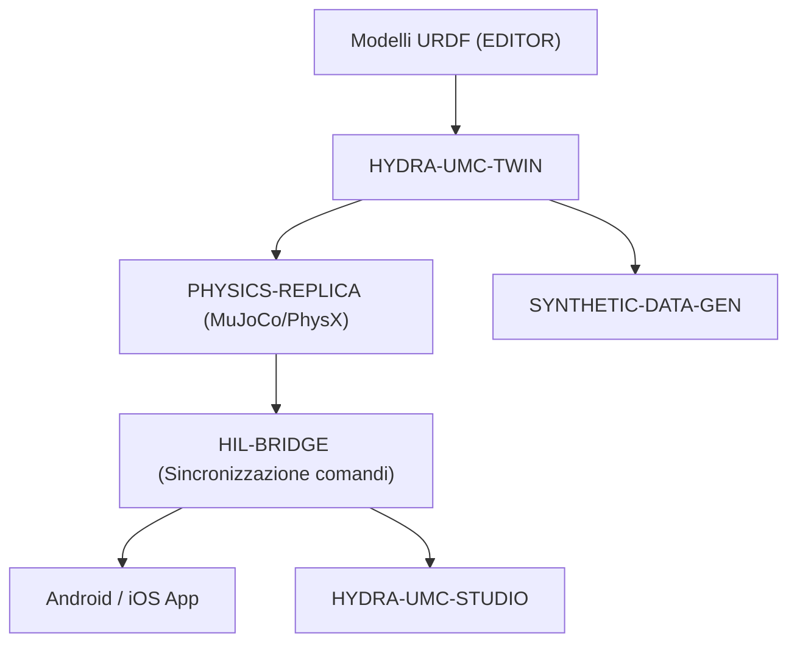

<!-- =============================================================================
HYDRA-UMC-TWIN - Digital Twin integration hub
Copyright (C) JuanenRac (Electro Hobby 3D) <electrohobby3d@gmail.com>
GPL-3.0-or-later - see LICENSE
============================================================================= -->

<p align="center">
  
</p>

# 🪞 HYDRA-UMC-TWIN

<p align="center"><a href="README.md">🇺🇸 English</a> | <a href="README_spa.md">🇪🇸 Español</a> | <a href="README_fra.md">🇫🇷 Français</a> | 🇮🇹 <b>Italiano</b> | <a href="README_deu.md">🇩🇪 Deutsch</a> | <a href="README_zho.md">🇨🇳 简体中文</a> | <a href="README_jpn.md">🇯🇵 日本語</a> | <a href="README_por.md">🇵🇹 Português</a></p>

### 🌐 Digital Twin basata sulla fisica e motore di simulazione ad alta fedeltà

<p align="center">
  
  
  
  
  
  
  
</p>

---

> **Stato di sicurezza (safety e security):** questo ecosistema non è un sistema di sicurezza certificato. Non esiste ancora un percorso E-STOP hardware, né limiti o interblocchi imposti dal firmware, né un comando di movimento verificato; le immagini firmware sono controllate con CRC-32 e una firma Ed25519, e una compilazione di rilascio rifiuta le chiavi di sviluppo pubblicate (le teste utensile e le schede di espansione dietro il relè usano ancora i bootloader di URTC, che accettano un HMAC-SHA256 a chiave condivisa invece di una firma); TLS e TLS reciproco sono opzionali e disattivati per impostazione predefinita; nessuna scheda propria è stata ancora assemblata o provata. Leggi la [base di sicurezza](https://github.com/JuanenRac/HYDRA-UMC-DOCS/blob/main/docs/SECURITY_BASELINE.md) e il [modello delle minacce](https://github.com/JuanenRac/HYDRA-UMC-DOCS/blob/main/docs/THREAT_MODEL.md) prima di fidarti di qualsiasi affermazione qui per la sicurezza di una persona.

---

## 📋 In breve

| | |
|---|---|
| Versione | `0.1.1` |
| Maturità | Funzionale |
| Test | 78 (`cargo test`) |
| Tecnologia | Rust / tiny_http |
| Destinazione | Il Raspberry Pi CM5 di una cella HYDRA-UMC |
| Su hardware reale | Non ancora: per questa versione non risulta alcuna esecuzione su hardware reale |

**Vai a:** [Panoramica](#-panoramica) · [Architettura](#-architettura) · [Sicurezza e protezione](#-sicurezza-e-protezione) · [Configurazione](#-configurazione) · [Avvio rapido](#-avvio-rapido) · [Test](#-test) · [Struttura del repository](#-struttura-del-repository) · [Progetti correlati](#-progetti-correlati)

## 🚦 Stato del progetto

Ogni riga è una parte di questo repository e il semaforo dice a che punto è oggi. È scritta in base a ciò che il repository può mostrare (test, compilazioni, esecuzioni), non a ciò che è previsto.

🟢 Fatto e verificato · 🟡 Funziona, con limiti noti · 🟠 Fatto a metà o non ancora verificato · 🔴 Non fatto o non funzionante

| Area | Stato | Cosa significa qui |
|---|---|---|
| Software | 🟡 | Funziona per il suo scopo principale; la verifica di onestà qui sopra elenca ciò che manca ancora |
| Test | 🟢 | 78 test automatici, eseguiti a ogni modifica |
| Hardware reale | 🔴 | Non ancora: per questa versione non risulta alcuna esecuzione su hardware reale |
| Documentazione | 🟢 | README in otto lingue, verificato rispetto al manifesto a ogni modifica |

## 🎯 Panoramica

**HYDRA-UMC-TWIN** è pensato per diventare il cuore virtuale dell'ecosistema: una replica basata sulla fisica della micro-fabbrica per testare, addestrare e monitorare sciami robotici in sicurezza. Nulla di tutto ciò esiste ancora.

Scritto in Rust, oggi legge i manifesti dei suoi tre figli (PHYSICS-REPLICA, HIL-BRIDGE, SYNTHETIC-DATA-GEN) e verifica se ciascuno è pronto per la sincronizzazione. Il motore fisico Bevy/URDF che emulerebbe inerzia, attrito e coppia motore («se funziona nel Twin, funziona in officina») è pianificato, non ancora implementato.

### Caratteristiche principali:
* 🧩 **Controllo di disponibilità della famiglia (v0):** il vero sottocomando `family-status` legge il vero `hydra-umc.project.json` proprio di ciascuno dei 3 veri figli e riporta presenza/versione/maturità/ruolo - onesto per un hub di integrazione che ancora non esegue alcun motore da solo. Vedi "Verifica di onestà" sotto.
* 🔒 **Reale v0 - Contratto di sincronizzazione dello stato:** `family-sync` filtra ogni figlio secondo un contratto reale e testabile - maturità minima (`functional`) e una versione major massima compatibile - prima di trattarlo come pronto per la sincronizzazione, rifiutando un figlio immaturo o con versione incompatibile con una vera motivazione invece di sincronizzare contro una forma di stato non verificata.
* 🔏 **Certificati di interblocco:** `POST /interlock/certify` firma un rapporto di rischio (articolazione, posizione, `collision_imminent`, `distance_m`) con la chiave Ed25519 del gemello e restituisce un certificato che HYDRA-UMC-HIL-BRIDGE accetta solo per quel comando (recente, a uso singolo) prima di inviare qualcosa all'hardware reale. La rotta esiste solo se il server parte con `--signing-key-file` e `--certify-token-file` (o `HYDRA_UMC_TWIN_CERTIFY_TOKEN`): senza il token nessuno può chiedere una firma, senza chiave la rotta risponde `404`, e l'uno senza l'altra non parte. `keygen --key-file PERCORSO` crea una chiave (mai sopra un file esistente) e stampa la chiave pubblica da dare al bridge. Finché non esiste il motore di fisica, il gemello firma il rapporto di chi chiama con il token (la replica di fisica), non uno calcolato da sé: un certificato vale quanto la sua fonte. Il formato è in `docs/INTERLOCK_CERTIFICATE.md`. *(implementato, provato contro il vero binario del bridge)*
* 🔌 **API JSON via HTTP (v0):** `serve [--addr ADDR] [--port PORT] [--workspace PERCORSO]` (default `127.0.0.1:8111`) espone la stessa identica logica family-status/family-sync tramite `GET /family-status`, `GET /family-sync`, `GET /stats` attraverso un vero server `tiny_http` bloccante - lo stesso binario che l'unità `systemd/hydra-umc-twin.service` esegue su una CM5 distribuita (solo loopback). Vedi [`docs/CLI_REFERENCE.md`](docs/CLI_REFERENCE.md) per il contratto completo.
* 🩺 **Controllo attivo della salute dei figli (v0):** `family-health` non si fida dei manifesti: esegue il binario compilato di PHYSICS-REPLICA su un URDF di prova e ne confronta la posa con quella esatta, e chiama `GET /stats` del ponte HIL in esecuzione (`--physics-replica-bin`, `--hil-bridge-addr`, `--timeout-ms`). Un figlio che non si può eseguire né raggiungere, o che risponde in modo errato, viene segnalato come tale; SYNTHETIC-DATA-GEN non ha nulla da eseguire e risulta non sondato. `serve --health-probes` aggiunge `GET /family-health` (spento per impostazione predefinita, risposte in cache, la richiesta non sceglie mai cosa viene eseguito). *(implementato)*
* 🌐 **Simulazione completa della fabbrica (previsto):** replica robot, strumenti e l'ambiente in uno spazio 3D unificato - dipende dall'esistenza preventiva di una vera integrazione del motore Bevy.
* ⚡ **Hardware-in-the-loop (HIL) (previsto):** collega App e Studio al simulatore come se fosse un vero controller.
* 📊 **Previsione dell'usura (previsto):** stima la durata dei componenti in base allo stress meccanico simulato.
* 🛡️ **Validazione della sicurezza (previsto):** test di traiettorie complesse ed evitamento delle collisioni prima dell'esecuzione fisica.

**Verifica di onestà - cosa funziona davvero oggi:** l'invocazione senza argomenti continua a stampare identità/versione/ruolo, ma ora esistono tre veri sottocomandi. `family-status [--workspace PERCORSO]` legge i veri manifesti propri di `HYDRA-UMC-PHYSICS-REPLICA`/`HYDRA-UMC-HIL-BRIDGE`/`HYDRA-UMC-SYNTHETIC-DATA-GEN` da un checkout locale e riporta onestamente ciò che trova. `family-sync [--workspace PERCORSO]` va oltre: fa passare ogni figlio presente attraverso un vero contratto di sincronizzazione dello stato (maturità minima `functional`, versione major massima compatibile) e riporta `READY`, `REJECTED (immature)`, `REJECTED (incompatible version)` o `MISSING` per figlio. `serve` espone entrambi tramite vero HTTP JSON invece di invocazioni CLI singole. Non esiste ancora nessuna app Bevy, nessun rendering, nessun ciclo fisico, nessun caricamento di scene URDF, né alcun vero trasporto di sincronizzazione di rete - vedi [`CHANGELOG.md`](CHANGELOG.md) per ciò che è stato consegnato esattamente, [`docs/CLI_REFERENCE.md`](docs/CLI_REFERENCE.md) per ogni comando/endpoint, e la Roadmap sotto per ciò che resta da fare.

## 🧩 Ruolo in HYDRA-UMC

**HYDRA-UMC-TWIN** è il genitore di integrazione della famiglia Digital Twin. Legge i manifesti dei suoi tre figli, indica se la famiglia è pronta e allineata, ne verifica lo stato di salute e firma certificati di interblocco che dicono al ponte hardware-in-the-loop che un rapporto di rischio proviene dal gemello. Il motore fisico vero e proprio è ancora previsto.

## 🏛️ Architettura

<p align="center">
  
</p>

<details>
<summary>Versione testuale del diagramma (Mermaid)</summary>



</details>

### ARCHITETTURA E DECISIONI DI PROGETTAZIONE

* **Perché questo motore non ha cartelle `hardware/`/`firmware/`/`os/`.** Software puro senza scheda propria; le cartelle sorgente sono incluse solo quando richieste dall'implementazione.
* **Perché `Cargo.toml` deliberatamente non ha ancora una dipendenza Bevy.** Bevy è un motore grafico pesante - tempi di compilazione lunghi, richiede una toolchain GPU/grafica non sempre disponibile. v0 ha aggiunto solo `serde`/`serde_json`/`tiny_http` (per leggere i manifesti dei figli) - il vero lavoro di rendering attende ancora che esista una vera toolchain GPU/grafica contro cui compilare.
* **Perché `docker-compose.blueprint.yml` esiste prima che i suoi 3 figli abbiano un Dockerfile.** Decidere e documentare ora il contratto di integrazione (quale servizio dipende da quale, quali mount di device/volume servono a ciascuno) evita che questa forma venga inventata più tardi in modo estemporaneo, anche se `docker compose up` non può avere pieno successo finché ogni figlio non pubblica il proprio Dockerfile.
* **Come si inserisce nel resto dell'ecosistema.** Il genitore di integrazione della famiglia Gemello Digitale e Simulazione - HYDRA-UMC-PHYSICS-REPLICA gli fornisce un vero risolutore fisico, HYDRA-UMC-HIL-BRIDGE permette ad app reali di controllarlo come se fosse hardware, e HYDRA-UMC-SYNTHETIC-DATA-GEN renderizza dataset di addestramento tramite il suo stesso motore.
* **Perché `family-status` legge il manifesto proprio di ogni figlio invece di una lista mantenuta a mano.** `hydra-umc.project.json` è già l'unica fonte di verità di cui si fidano dashboard/updater dell'ecosistema - una seconda lista qui andrebbe fuori sincrono nel momento in cui la vera maturità di un figlio cambiasse e nessuno si ricordasse di aggiornarla.
* **Perché un checkout fratello assente è un vero "non trovato" onesto, non un crash.** Un hub di integrazione non può davvero sapere se uno sviluppatore ha tutti e 3 i figli clonati localmente - `manifest.rs` restituisce `None` per ogni vero modo di fallimento (repository assente, file assente, JSON malformato) così che `family-status` possa riportarlo chiaramente invece di andare in panico.
* **Perché `family-sync` filtra sia per maturità SIA per un tetto di versione, non solo per "è presente".** `family-status` risponde già a "questo figlio è clonato e cosa dichiara di sé" - ma un figlio clonato con maturità `scaffolding` non ha ancora uno stato reale che valga la pena sincronizzare, e un figlio che ha superato la versione major massima verificata da questo Twin potrebbe aver cambiato la propria forma di stato in un modo che questo Twin non conosce ancora. Entrambe sono ragioni reali per rifiutare la sincronizzazione, distinte da "assente", quindi `contract.rs` le controlla e le riporta separatamente invece di fondere tutto in un generico "non pronto".
* **Perché la maturità viene controllata prima della compatibilità di versione in `contract::assess()`.** Il numero di versione di un figlio immaturo non è ancora un segnale significativo - controllare prima la maturità significa che la motivazione di rifiuto riportata nomina sempre la porta più fondamentale che è effettivamente fallita, invece che un disallineamento di versione mascheri un problema più basilare del tipo "questo figlio non è ancora reale".

**Contratti verificati con JSON Schema.** `validate-state FILE` verifica uno stato del gemello (il contratto `TwinState` dell'SDK: stati dei giunti, pose con nome, istante, sistema di riferimento e se lo stato è `real` o `simulated`) rispetto al suo schema, e rifiuta un quaternione di posa che non abbia lunghezza unitaria e un giunto nominato due volte. Il manifesto di un figlio che dichiara `schema_version` viene convalidato rispetto allo schema del manifesto di progetto dell'SDK con la crate `jsonschema` (Draft 2020-12, formati verificati); entrambi gli schemi sono inclusi in `schemas/`.

## 🔒 Sicurezza e protezione

| Minaccia | Difesa | Dove |
|---|---|---|
| Un rapporto di rischio scritto da chi vuole muovere il robot | Il rapporto viaggia come certificato firmato con la chiave Ed25519 del gemello; il ponte ha solo la metà pubblica, quindi nessuno che lo raggiunga può crearne uno | `src/certificate.rs`, `docs/INTERLOCK_CERTIFICATE.md` |
| Chiunque chieda al gemello di firmare | `POST /interlock/certify` esiste solo se il gemello parte con una chiave di firma e un token di certificazione; il suo corpo è limitato a 4 KiB e `keygen` non sovrascrive mai un file e lo scrive con modo 0600 su Unix | `src/server.rs`, `src/main.rs` |

**Cosa non fa mai:** simulare la fisica, per ora. Finché il motore non esiste, il gemello firma il rapporto di chi ha il token di certificazione; un certificato vale quanto la fonte del rapporto.

Il parametro `?workspace=` dell'API HTTP è limitato per impostazione predefinita all'area di lavoro servita, così che una richiesta non possa far esaminare all'API altre directory della macchina; `--strict-workspace-root PERCORSO` sceglie un'altra radice e `--allow-any-workspace` ripristina il comportamento precedente, senza limiti.

## ⚙️ Configurazione

| Variabile | Predefinito | Cosa imposta |
|---|---|---|
| `--addr` | `127.0.0.1` | indirizzo dell'API HTTP |
| `--port` | `8111` | porta dell'API HTTP |
| `--workspace` | la cartella che contiene questo repository | dove si cercano i repository fratelli |
| `--physics-replica-bin` / `HYDRA_UMC_TWIN_PHYSICS_REPLICA_BIN` | nessuno | binario della replica fisica avviato dal controllo di salute |
| `--hil-bridge-addr` / `HYDRA_UMC_TWIN_HIL_ADDR` | nessuno | host:porta del ponte hardware-in-the-loop sondato |
| `--timeout-ms` | `5000` | tempo concesso a ogni sonda di salute |
| `--signing-key-file` / `HYDRA_UMC_TWIN_SIGNING_KEY_FILE` | nessuno | chiave Ed25519 che attiva la firma dei certificati |
| `--certify-token-file` / `HYDRA_UMC_TWIN_CERTIFY_TOKEN` | nessuno | token richiesto da `POST /interlock/certify` |

## 🚀 Avvio rapido

Richiede la toolchain Rust stabile (edizione 2021) con `cargo`.

```bash
./build.sh  # Linux, macOS (build.bat on Windows)
./run.sh family-status
./run.sh family-sync
./run.sh serve --port 8111
./run.sh keygen --key-file twin.key
```

## 🧪 Test

78 test automatici si eseguono con `cargo test`. Non richiedono hardware né nulla al di fuori di questa macchina.

La CI esegue `HYDRA_UMC_CI=1 python tools/ci_validate.py`, che controlla il manifesto, i documenti, gli otto README e le immagini.

## 🏗️ Compilazione e rilascio

Richiede il toolchain Rust (`cargo`/`rustc`, installabile via [rustup](https://rustup.rs)) e Python 3.10+ (solo per `bump_version.py`).

```bash
# Linux / macOS
./build.sh   # `cargo test` (78 test), poi `cargo build --release`
./run.sh     # esegue target/release/hydra-umc-twin, stampa nome + version + ruolo
```

```bat
:: Windows
build.bat
run.bat
```

`build.sh`/`build.bat` non cambiano mai la versione (solo `python tools/hydra_project_tool.py bump` la alza), eseguono la vera suite di test, e poi costruiscono un binario release.

Il vero sottocomando `family-status` controlla il vero checkout locale:

```bash
./run.sh family-status
./run.sh family-status --workspace /percorso/verso/un/altro/checkout

# Windows
run.bat family-status
```

```text
Digital Twin family status (workspace: /percorso/verso/GitHub):
  HYDRA-UMC-PHYSICS-REPLICA: v0.0.6, maturity=established, role=library
  HYDRA-UMC-HIL-BRIDGE: v0.0.8, maturity=established, role=service
  HYDRA-UMC-SYNTHETIC-DATA-GEN: v0.0.9, maturity=established, role=tool

All 3 children present.
```

Per default usa la propria directory padre di questo repository - la vera disposizione checkout-fratello che questo ecosistema già usa. Esce con `1` se manca qualche vero figlio.

Il vero sottocomando `family-sync` va oltre - controlla anche il vero contratto di sincronizzazione dello stato (maturità minima, versione major massima compatibile) per ogni figlio presente:

```bash
./run.sh family-sync --workspace /percorso/verso/un/checkout
```

```text
Digital Twin family sync contract (workspace: /percorso/verso/un/checkout):
  HYDRA-UMC-PHYSICS-REPLICA: READY (v0.0.6, maturity=functional)
  HYDRA-UMC-HIL-BRIDGE: REJECTED (incompatible version) - HYDRA-UMC-HIL-BRIDGE reports major version 1 - this Twin's sync contract is only verified up to major 0 (incompatible simulator version)
  HYDRA-UMC-SYNTHETIC-DATA-GEN: MISSING (not checked out)

Not every child is sync-ready - see the lines above.
```

Esce con `0` solo se ogni figlio atteso è `READY`; `1` per qualsiasi figlio `MISSING`/`REJECTED`.

**Importante:** `Cargo.toml` deliberatamente **non ha ancora la dipendenza Bevy**. Bevy è un motore grafico pesante (tempi di compilazione lunghi, richiede un toolchain GPU/grafico non sempre disponibile); v0 ha aggiunto solo `serde`/`serde_json`/`tiny_http` per leggere i manifesti. La vera dipendenza `bevy` (più un backend fisico e il client gRPC/WebSocket per HIL-BRIDGE) verrà aggiunta quando inizierà il vero lavoro di rendering/motore.

### Integrazione dei 3 figli (`docker-compose.blueprint.yml`)

Come padre di integrazione, `docker-compose.blueprint.yml` documenta come questo motore compone i suoi 3 figli in un unico stack: **PHYSICS-REPLICA** (solver, chiamato a ogni tick fisico), **HIL-BRIDGE** (sincronizzazione comandi reale vs virtuale) e **SYNTHETIC-DATA-GEN** (esportazione dataset a lotti, offline). Nessuno dei 4 progetti ha ancora un `Dockerfile` in questa fase di scheletro, quindi `docker compose up` non è eseguibile oggi; il file è il riferimento confermato di topologia, porte e dipendenze dei Dockerfile futuri.

## 📂 Struttura del repository

<p align="center">
  
</p>

<details>
<summary>Versione testuale dell'albero</summary>

```text
HYDRA-UMC-TWIN/
├── src/                             codice sorgente
│   ├── manifest.rs                  Lettore reale e difensivo del manifesto proprio di un fratello
│   ├── family.rs                    Vero controllo di disponibilità + esito di sync combinato
│   ├── contract.rs                  Vero contratto di sync di stato (maturità + tetto di version)
│   ├── certificate.rs               Certificati di interblocco Ed25519: il testo firmato, la firma, i nonce, la generazione delle chiavi
│   ├── health.rs                    Sonde attive dei figli: esegue il binario di PHYSICS-REPLICA, chiama il ponte HIL
│   ├── server.rs                    Superficie JSON/HTTP semplice (tiny_http, bloccante, senza runtime async)
│   └── main.rs                      Entry point + veri sottocomandi `family-status`/`family-sync`
├── docs/                            Documentazione e ottimizzazione fisica
├── images/                          Media e diagrammi
├── systemd/                         unità di servizio
├── tools/                           strumenti del progetto e controlli della CI
├── .github/                         workflow di CI e modelli di segnalazione
├── Cargo.toml                       Metadati del pacchetto, dipendenze (serde/serde_json), version contachilometri
├── bump_version.py                  Incremento di versione stile contachilometri (eseguito solo dal comando `bump` esplicito)
├── build.sh / build.bat             Valida e compila (compilare non cambia mai la versione)
├── build-test.sh / build-test.bat   Controllo build senza versionamento
├── run.sh / run.bat                 Esegue il binario release compilato (inoltra gli argomenti)
├── docker-compose.blueprint.yml     Blueprint di integrazione dei 3 figli sotto
├── CHANGELOG.md                     cosa è cambiato in ogni versione
├── bump_manifest_version.py         sincronizza la versione del manifesto
├── hydra-umc.project.json           manifesto: versione, maturità, famiglia
└── test.sh                          esegue i test
```

</details>

## 🗺️ Roadmap e limiti noti

**Limiti noti oggi**

* **Fase 1:** Sincronizzazione del Digital Twin con telemetria hardware in tempo real e latenza inferiore a 10 ms.
* **Fase 2:** Integrazione di Physics Replica con simulatori di livello industriale (Isaac Sim) e supporto per corpi deformabili.
* **Fase 3:** Modelli di ripristino automatizzati di Node Healing per failover decentralizzato e rilevamento precoce del degrado dei sensori.
* **Fase 4:** Rendering fotorealistico per la generazione di dati sintetici e supporto HIL Bridge per test vehicle-in-the-loop su scala reale.

## 🌍 Lingue

Questo README e i documenti del repository esistono in otto lingue: inglese, spagnolo, tedesco, francese, italiano, giapponese, cinese e portoghese (Portogallo). Sono scritti insieme e la CI verifica che gli otto file abbiano le stesse sezioni e gli stessi link. Questo repository non ha uno schermo né un catalogo di messaggi propri, quindi non ci sono stringhe di interfaccia da tradurre.

## 🔗 Progetti correlati

Questo progetto fa parte dell'ecosistema robotico HYDRA-UMC dello stesso autore (JuanenRac / Electro Hobby 3D). Vale la pena conoscerlo, poiché una richiesta potrebbe in realtà riguardare uno di questi invece di questo repository.

**Progetti Figli** — ciascuno si collega al motore di simulazione/rendering di questo gemello
- **[HYDRA-UMC-PHYSICS-REPLICA](https://github.com/JuanenRac/HYDRA-UMC-PHYSICS-REPLICA)** — vera cinematica diretta e validazione dei limiti articolari su un vero sottoinsieme URDF.
- **[HYDRA-UMC-HIL-BRIDGE](https://github.com/JuanenRac/HYDRA-UMC-HIL-BRIDGE)** — router hardware-in-the-loop con un interblocco software di collisione tra simulazione e hardware reale (testato senza hardware reale).
- **[HYDRA-UMC-SYNTHETIC-DATA-GEN](https://github.com/JuanenRac/HYDRA-UMC-SYNTHETIC-DATA-GEN)** — vero generatore procedurale di scene 2D con esportazione di annotazioni YOLO/COCO.

**Direttamente Correlati**
- **[HYDRA-UMC-EDITOR-URDF](https://github.com/JuanenRac/HYDRA-UMC-EDITOR-URDF)** — creatore/editor grafico desktop di URDF che invia i modelli finiti al catalogo di STUDIO; lo strumento con cui vengono creati i modelli URDF consumati da questo gemello.
- **[HYDRA-UMC-EDITOR-STL](https://github.com/JuanenRac/HYDRA-UMC-EDITOR-STL)** — editor desktop di modelli STL, che trasforma/sostituisce/rimuove/aggiunge veri pezzi nello stesso catalogo di modelli modificato anche da HYDRA-UMC-EDITOR-URDF.
- **[HYDRA-UMC-SUITE](https://github.com/JuanenRac/HYDRA-UMC-SUITE)** — centro di comando sciame desktop (PySide6) per più server contemporaneamente, pacchettizzato come eseguibile standalone; è pensata per controllare questo gemello come se fosse hardware reale, tramite HIL-BRIDGE (previsto).
- **[HYDRA-UMC-ANDROID-CONTROL](https://github.com/JuanenRac/HYDRA-UMC-ANDROID-CONTROL)** — app di controllo nativa per Android con login biometrico e un companion Wear OS abbinato; è pensata per controllare questo gemello come se fosse hardware reale, tramite HIL-BRIDGE (previsto).
- **[HYDRA-UMC-IOS-CONTROL](https://github.com/JuanenRac/HYDRA-UMC-IOS-CONTROL)** — app di controllo per iOS/iPadOS (Flutter) con sincronizzazione WebSocket in tempo reale; è pensata per controllare questo gemello come se fosse hardware reale, tramite HIL-BRIDGE (previsto).

**Fa Anche Parte dell'Ecosistema**

*Hardware e Piattaforma di Base*
- **[HYDRA-UMC](https://github.com/JuanenRac/HYDRA-UMC)** — il progetto della scheda madre del braccio robotico: host CM5 + coprocessore STM32H745 dual-core, pensato per coordinare fino a 8 bracci utensile via CAN-OTA/SPI-OTA (firmware in fase iniziale; nessuna scheda assemblata per ora).
- **[HYDRA-UMC-OS](https://github.com/JuanenRac/HYDRA-UMC-OS)** — livello prodotto riproducibile su Raspberry Pi OS per il CM5: agente in sola lettura, config/profili validati, provisioning WiFi al primo contatto.
- **[HYDRA-UMC-SDK](https://github.com/JuanenRac/HYDRA-UMC-SDK)** — il contratto JSON-Schema condiviso e la barriera software di controllo dei job contro cui ogni bridge valida i propri comandi (non è una funzione di sicurezza certificata).
- **[HYDRA-UMC-CONNECTOR-HUB](https://github.com/JuanenRac/HYDRA-UMC-CONNECTOR-HUB)** — registro dichiarativo e validatore di manifesti adattatore per connettori di macchine esterne; estende la propria idea di contratto dell'SDK alle macchine esterne senza sostituire i progetti di gateway industriale.

*Backend Centrale e Client*
- **[HYDRA-UMC-SERVER](https://github.com/JuanenRac/HYDRA-UMC-SERVER)** — il vero backend headless (REST/WebSocket) con cui parla davvero ogni client di controllo.
- **[HYDRA-UMC-STUDIO](https://github.com/JuanenRac/HYDRA-UMC-STUDIO)** — dashboard di controllo web con visualizzazione 3D multi-robot in tempo reale.
- **[HYDRA-UMC-DSI](https://github.com/JuanenRac/HYDRA-UMC-DSI)** — interfaccia touch nativa per il touchscreen DSI da 7" a bordo, incorporata direttamente nel CM5.
- **[HYDRA-UMC-BRIDGE-AMR](https://github.com/JuanenRac/HYDRA-UMC-BRIDGE-AMR)** — barriera di coordinamento per flotte AGV/AMR tramite un publisher MQTT VDA 5050 (testato solo contro una flotta emulata).
- **[HYDRA-UMC-BRIDGE-CNC](https://github.com/JuanenRac/HYDRA-UMC-BRIDGE-CNC)** — coordinatore ad alto livello per celle CNC con accesso a stato/byte di controllo GRBL (testato solo contro un emulatore).
- **[HYDRA-UMC-BRIDGE-DROIDS](https://github.com/JuanenRac/HYDRA-UMC-BRIDGE-DROIDS)** — barriera di coordinamento per droidi con zampe/umanoidi, con un mittente di comandi per Boston Dynamics Spot (testato solo contro un emulatore).
- **[HYDRA-UMC-BRIDGE-LASER](https://github.com/JuanenRac/HYDRA-UMC-BRIDGE-LASER)** — coordinatore per celle laser che legge 3 segnali GPIO di chiave/involucro/interblocco (testato solo contro un chip simulato; non può armare né far partire un laser).
- **[HYDRA-UMC-BRIDGE-OPENPNP](https://github.com/JuanenRac/HYDRA-UMC-BRIDGE-OPENPNP)** — coordinatore ad alto livello sicuro per il flusso schede del pick-and-place OpenPnP.
- **[HYDRA-UMC-BRIDGE-PRINTER3D](https://github.com/JuanenRac/HYDRA-UMC-BRIDGE-PRINTER3D)** — barriera di coordinamento sicura per stampanti 3D Moonraker/Klipper, con comandi di lavoro reali e controllati.
- **[HYDRA-UMC-BRIDGE-ROS2](https://github.com/JuanenRac/HYDRA-UMC-BRIDGE-ROS2)** — coordinatore con un trasporto ROS 2 rclpy importato in modo lazy (non ancora eseguito contro un'installazione ROS 2).
- **[HYDRA-UMC-BRIDGE-UAV](https://github.com/JuanenRac/HYDRA-UMC-BRIDGE-UAV)** — barriera di coordinamento per UAV dotati di fotocamera, con un mittente di comandi MAVLink (testato solo contro un emulatore).

*Piattaforma Strumenti URTC*
- **[URTC](https://github.com/JuanenRac/URTC)** — firmware per la scheda fisica dell'Universal Robot Tool Controller, oltre 25 profili utensile su bus CAN.
- **[URTC-FLASHER](https://github.com/JuanenRac/URTC-FLASHER)** — strumento desktop con GUI per il flashing delle schede URTC, CAN-OTA più SWD/JTAG a chip intero.
- **[URTC-TESTER](https://github.com/JuanenRac/URTC-TESTER)** — strumento desktop di diagnostica CAN-bus dal vivo per schede URTC, un pannello per profilo utensile.
- **[URTC-WEB-STUDIO](https://github.com/JuanenRac/URTC-WEB-STUDIO)** — alternativa basata su browser a URTC-TESTER tramite la Web Serial API, senza installazione locale.
- **[URTC-GATEWAY](https://github.com/JuanenRac/URTC-GATEWAY)** — gateway davanti al bus CAN di URTC: elenco di identificatori consentiti, limite di frequenza e chiave di sessione; software provato su computer, non ancora su un bus reale.

*Nodo IA Visione (Hailo-8)*
- **[HYDRA-UMC-VISION-NODE](https://github.com/JuanenRac/HYDRA-UMC-VISION-NODE)** — hub di integrazione per la pipeline di visione Hailo-8, con un vero controllo di prontezza hardware per fase.
- **[HYDRA-UMC-DETECTION-HEF](https://github.com/JuanenRac/HYDRA-UMC-DETECTION-HEF)** — registro reale di modelli compilati con verifica di caricamento sicuro per architettura Hailo/checksum.
- **[HYDRA-UMC-VISION-STREAMER](https://github.com/JuanenRac/HYDRA-UMC-VISION-STREAMER)** — generatore reale di pipeline GStreamer + config MediaMTX, con una vera barriera di integrazione HailoRT.
- **[HYDRA-UMC-VISUAL-SERVOING-API](https://github.com/JuanenRac/HYDRA-UMC-VISUAL-SERVOING-API)** — legge di correzione Position-Based Visual Servoing con autorizzazione condizionata allo stato di zona; ancora nessuna stima di posa da telecamera.
- **[HYDRA-UMC-SAFETY-ZONES](https://github.com/JuanenRac/HYDRA-UMC-SAFETY-ZONES)** — logica v0 di violazione zona, freschezza di calibrazione e richiesta E-STOP che legge le posizioni degli oggetti da un file; nessun rilevatore la alimenta e nessun E-STOP fisico è ancora collegato.

*Nodo IA Cognitivo (Hailo-10)*
- **[HYDRA-UMC-COGNITIVE-NODE](https://github.com/JuanenRac/HYDRA-UMC-COGNITIVE-NODE)** — hub di integrazione per la pipeline cognitiva Hailo-10 (orchestrazione LLM/VLA/voce).
- **[HYDRA-UMC-VLA-ENGINE](https://github.com/JuanenRac/HYDRA-UMC-VLA-ENGINE)** — vera codifica/decodifica di token d'azione e generazione di traiettoria per un modello Vision-Language-Action.
- **[HYDRA-UMC-VOICE-UI](https://github.com/JuanenRac/HYDRA-UMC-VOICE-UI)** — vero front-end vocale (VAD + parser di intenti) con un relay verso Watch limitato e soggetto a conferma.
- **[HYDRA-UMC-SEMANTIC-PLANNER](https://github.com/JuanenRac/HYDRA-UMC-SEMANTIC-PLANNER)** — vera scomposizione dei task basata su regole e recupero semantico degli errori sui codici errore MCU.
- **[HYDRA-UMC-DOCS-QA](https://github.com/JuanenRac/HYDRA-UMC-DOCS-QA)** — vera ricerca documentale TF-IDF (solo libreria standard) sui documenti Markdown di questo ecosistema.
- **[HYDRA-UMC-LOCAL-TECHNICIAN](https://github.com/JuanenRac/HYDRA-UMC-LOCAL-TECHNICIAN)** — tecnico di manutenzione IA locale e con cancelli di policy per l'ecosistema stesso - osserva, diagnostica e propone correzioni; i due livelli di rischio più alti non sono deliberatamente ancora implementati.

*Orchestrazione e Sciame*
- **[HYDRA-UMC-ORCHESTRATOR](https://github.com/JuanenRac/HYDRA-UMC-ORCHESTRATOR)** — hub di integrazione con un vero contratto di health-report gRPC/Protobuf e una macchina a stati di missione.
- **[HYDRA-UMC-JOB-DISPATCHER](https://github.com/JuanenRac/HYDRA-UMC-JOB-DISPATCHER)** — vera coda di lavori basata su priorità con deduplicazione, su una vera API HTTP.
- **[HYDRA-UMC-NODE-HEALING](https://github.com/JuanenRac/HYDRA-UMC-NODE-HEALING)** — vero watchdog di salute della flotta basato su gRPC, con retry/backoff e rilevamento di discrepanza d'identità.
- **[HYDRA-UMC-PATH-PLANNER-3D](https://github.com/JuanenRac/HYDRA-UMC-PATH-PLANNER-3D)** — vero pianificatore di percorsi 3D basato su RRT, con vera validazione delle collisioni ostacolo/spazio di lavoro.
- **[HYDRA-UMC-SWARM-SYNC](https://github.com/JuanenRac/HYDRA-UMC-SWARM-SYNC)** — vera sincronizzazione di stato CRDT LWW-Element-Map, con property test per la convergenza multi-cella.

*Dati e Analisi*
- **[HYDRA-UMC-DATALAKE](https://github.com/JuanenRac/HYDRA-UMC-DATALAKE)** — vero archivio di serie temporali basato su sqlite3, con una vera API HTTP di ingestione/query.
- **[HYDRA-UMC-ANOMALY-DETECTOR](https://github.com/JuanenRac/HYDRA-UMC-ANOMALY-DETECTOR)** — vero rilevatore di anomalie FFT + baseline statistica, con monitoraggio della deriva.
- **[HYDRA-UMC-PRODUCTION-REPORTS](https://github.com/JuanenRac/HYDRA-UMC-PRODUCTION-REPORTS)** — vero calcolo OEE/disponibilità sullo storico di DATALAKE, con esportazione CSV riproducibile.
- **[HYDRA-UMC-TELEMETRY-COLLECTOR](https://github.com/JuanenRac/HYDRA-UMC-TELEMETRY-COLLECTOR)** — vera pipeline di ingestione CAN/WebSocket verso DATALAKE, con deduplicazione per sequenza.

*Gateway Industriale*
- **[HYDRA-UMC-GATEWAY-INDUSTRIAL](https://github.com/JuanenRac/HYDRA-UMC-GATEWAY-INDUSTRIAL)** — hub di integrazione che inoltra ai protocolli industriali, con un vero livello di allowlist dei comandi/backpressure.
- **[HYDRA-UMC-OPCUA-SERVER](https://github.com/JuanenRac/HYDRA-UMC-OPCUA-SERVER)** — vero spazio di indirizzi OPC-UA, verificato con una vera sessione client del protocollo binario.
- **[HYDRA-UMC-MQTT-BROKER](https://github.com/JuanenRac/HYDRA-UMC-MQTT-BROKER)** — vero broker MQTT con autenticazione opzionale per client e ACL sui topic.
- **[HYDRA-UMC-MTCONNECT-ADAPTER](https://github.com/JuanenRac/HYDRA-UMC-MTCONNECT-ADAPTER)** — veri endpoint XML `/probe` e `/current` di MTConnect, con output in modalità degradata.

*Strumenti Complementari e Operazioni dell'Ecosistema*
- **[HYDRA-UMC-DASHBOARD-AI](https://github.com/JuanenRac/HYDRA-UMC-DASHBOARD-AI)** — pannelli Smart Summaries e Anomaly Highlighting su DATALAKE/ANOMALY-DETECTOR, con un fallback statistico onesto.
- **[HYDRA-UMC-TOOL-CLI](https://github.com/JuanenRac/HYDRA-UMC-TOOL-CLI)** — CLI di flotta con un vero e stabile contratto di exit-code, un client live reale della stessa API di HYDRA-UMC-SERVER.
- **[HYDRA-UMC-WATCH](https://github.com/JuanenRac/HYDRA-UMC-WATCH)** — app companion WearOS con schemi di avviso aptico e un relay vocale verso il telefono abbinato (non ancora eseguita su un orologio fisico).
- **[URTC-SMART-RACK](https://github.com/JuanenRac/URTC-SMART-RACK)** — firmware per un rack di montaggio schede con decodifica reale dell'ID utensile e logica di preriscaldamento Smart Idle.
- **[URTC-VISION-TOOL](https://github.com/JuanenRac/URTC-VISION-TOOL)** — firmware più un vero companion di visione Python per una testa utensile di ispezione termica/RGB.
- **[HYDRA-UMC-UPDATER](https://github.com/JuanenRac/HYDRA-UMC-UPDATER)** — strumento amministrativo desktop che scopre, clona e aggiorna ogni repository di questo ecosistema.
- **[HYDRA-UMC-OS-REBUILDER](https://github.com/JuanenRac/HYDRA-UMC-OS-REBUILDER)** — strumento desktop Windows/Linux che costruisce un'immagine della CM5 pronta da scrivere, precaricata con le versioni più aggiornate dell'ecosistema, con configurazione di primo avvio Wi-Fi/utente/SSH in stile Raspberry Pi Imager.
- **[HYDRA-UMC-OPS-AGENT](https://github.com/JuanenRac/HYDRA-UMC-OPS-AGENT)** — coordinatore di incidenti di manutenzione: un ruolo edge a basso privilegio raccoglie uno snapshot di inventario/salute sanificato, un ruolo control-plane lo rende in sola lettura e chiede a un provider di IA di suggerire una diagnosi - non applica mai una patch né distribuisce nulla.
- **[HYDRA-UMC-DEV-SERVER](https://github.com/JuanenRac/HYDRA-UMC-DEV-SERVER)** — host di sviluppo riproducibile (Raspberry Pi 5 / CM5) che conserva il codice sorgente dell'ecosistema ed esegue attività delimitate di build/test tramite una coda durevole; un ruolo di sviluppo dedicato, esplicitamente distinto da un CM5 operativo.

## 📚 Documentazione

Dove leggere di più:

* **[docs/CLI_REFERENCE.md](docs/CLI_REFERENCE.md)** — ogni invocazione di `family-status`/`family-sync`/`serve`, output reale catturato da un binario di release compilato, la tabella dei codici di uscita, e il contratto HTTP JSON `GET /family-status`/`GET /family-sync`/`GET /stats`.
* [Base di sicurezza dell'ecosistema](https://github.com/JuanenRac/HYDRA-UMC-DOCS/blob/main/docs/SECURITY_BASELINE.md)
* [Modello delle minacce dell'ecosistema](https://github.com/JuanenRac/HYDRA-UMC-DOCS/blob/main/docs/THREAT_MODEL.md)
* [Registro delle modifiche di questo repository](CHANGELOG.md)
* [Licenza di questo repository](LICENSE.md)

## 🤝 Contribuire e comunità

* Prima di una pull request esegui `HYDRA_UMC_CI=1 py -3 tools/ci_validate.py` (oppure `HYDRA_UMC_CI=1 python3 tools/ci_validate.py`): deve stampare `CI_VALIDATION=PASS`. Non eseguire `build.sh` né `build.bat` per questa verifica; compilare non è verificare.
* I otto README sono scritti da un'unica fonte in HYDRA-UMC-DOCS; non modificarli a mano. Cambia la fonte e riscrivili con `tools/make_readmes.py`.
* Non affermare in un README ciò che non è stato eseguito: scrivi «simulato» o «non provato su hardware» quando è la verità.
* Vedi [CONTRIBUTING.md](CONTRIBUTING.md), il [codice di condotta](CODE_OF_CONDUCT.md), [SECURITY.md](SECURITY.md) e [SUPPORT.md](SUPPORT.md).

## 👤 AUTORE

**JuanenRac (Electro Hobby 3D)** · electrohobby3d@gmail.com

## 📜 LICENZA

GPL-3.0-or-later - [LICENSE](LICENSE).
