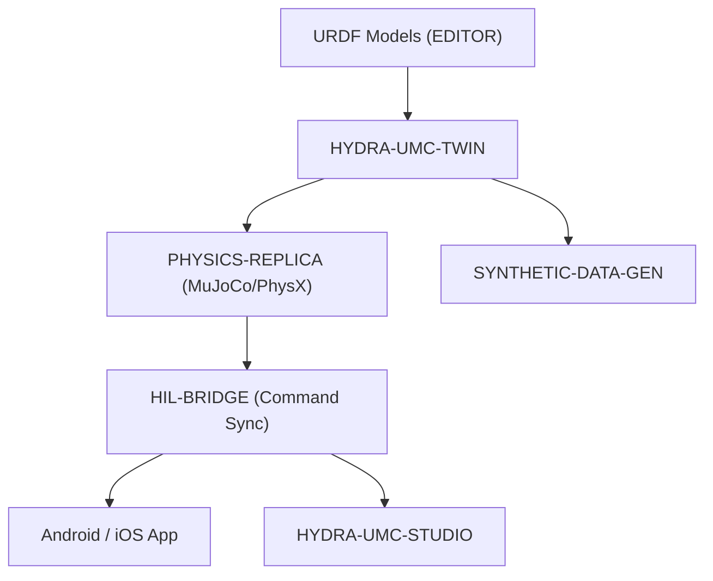

<!-- =============================================================================
HYDRA-UMC-TWIN - Digital Twin integration hub
Copyright (C) JuanenRac (Electro Hobby 3D) <electrohobby3d@gmail.com>
GPL-3.0-or-later - see LICENSE
============================================================================= -->

<p align="center">
  
</p>

# 🪞 HYDRA-UMC-TWIN

<p align="center"><a href="README.md">🇺🇸 English</a> | <a href="README_spa.md">🇪🇸 Español</a> | <a href="README_fra.md">🇫🇷 Français</a> | <a href="README_ita.md">🇮🇹 Italiano</a> | <a href="README_deu.md">🇩🇪 Deutsch</a> | <a href="README_zho.md">🇨🇳 简体中文</a> | <a href="README_jpn.md">🇯🇵 日本語</a> | 🇵🇹 <b>Português</b></p>

### 🌐 Gémeo digital baseado em física e motor de simulação de alta fidelidade

<p align="center">
  
  
  
  
  
  
  
</p>

---

> **Estado de segurança (safety e security):** este ecossistema não é um sistema de segurança certificado. Ainda não existe um caminho de E-STOP por hardware, nem limites ou interlocks impostos pelo firmware, nem um comando de movimento verificado; as imagens de firmware são verificadas com CRC32 e um HMAC-SHA256 de chave partilhada, não com uma assinatura assimétrica; TLS e TLS mútuo são opcionais e estão desativados por defeito; nenhuma placa própria foi ainda montada ou testada. Leia a [base de segurança](https://github.com/JuanenRac/HYDRA-UMC-DOCS/blob/main/docs/SECURITY_BASELINE.md) e o [modelo de ameaças](https://github.com/JuanenRac/HYDRA-UMC-DOCS/blob/main/docs/THREAT_MODEL.md) antes de confiar em qualquer afirmação aqui para a segurança de uma pessoa.

---

## 📋 Num relance

| | |
|---|---|
| Versão | `0.1.0` |
| Maturidade | Funcional |
| Testes | 77 (`cargo test`) |
| Tecnologia | Rust / tiny_http |
| Destino | O Raspberry Pi CM5 de uma célula HYDRA-UMC |
| Em hardware real | Ainda não: não há registo de execução em hardware real para esta versão |

**Ir para:** [Visão geral](#-visão-geral) · [Arquitetura](#-arquitetura) · [Segurança e proteção](#-segurança-e-proteção) · [Configuração](#-configuração) · [Início rápido](#-início-rápido) · [Testes](#-testes) · [Estrutura do repositório](#-estrutura-do-repositório) · [Projetos relacionados](#-projetos-relacionados)

## 🚦 Estado do projeto

Cada linha é uma parte deste repositório e a luz diz até onde chega hoje. É escrita com o que o repositório consegue demonstrar (testes, compilações, execuções), não com o que está previsto.

🟢 Feito e verificado · 🟡 Funciona, com limites conhecidos · 🟠 Feito a meio ou ainda por verificar · 🔴 Por fazer ou a não funcionar

| Área | Estado | O que significa aqui |
|---|---|---|
| Software | 🟡 | Funciona para o seu propósito principal; a verificação de honestidade acima lista o que ainda falta |
| Testes | 🟢 | 77 testes automáticos, executados a cada alteração |
| Hardware real | 🔴 | Ainda não: não há registo de execução em hardware real para esta versão |
| Documentação | 🟢 | README em oito idiomas, verificado contra o manifesto a cada alteração |

## 🎯 Visão geral

O **HYDRA-UMC-TWIN** destina-se a ser o coração virtual do ecossistema: uma réplica baseada em física da microfábrica para testar, treinar e monitorizar enxames robóticos em segurança. Nada disso existe ainda.

Escrito em Rust, hoje lê os manifestos dos seus três filhos (PHYSICS-REPLICA, HIL-BRIDGE, SYNTHETIC-DATA-GEN) e verifica se cada um está pronto para sincronizar. O motor de física Bevy/URDF que emularia inércia, atrito e binário dos motores («se funciona no Twin, funciona no chão de fábrica») está planeado, ainda não implementado.

### Funcionalidades principais:
* 🧩 **Verificação de prontidão da família (v0):** o subcomando real `family-status` lê o `hydra-umc.project.json` de cada um dos 3 filhos reais e reporta presença/versão/maturidade/papel - honesto para um hub de integração que ainda não executa nenhum motor. Ver «Verificação de honestidade» abaixo.
* 🔒 **v0 real - contrato de sincronização de estado:** o `family-sync` condiciona cada filho a um contrato real e testável - maturidade mínima (`functional`) e uma versão major máxima compatível - antes de o tratar como pronto para sincronizar, recusando um filho imaturo ou de versão incompatível com um motivo real em vez de sincronizar contra uma forma de estado não verificada.
* 🔏 **Certificados de interbloqueio:** `POST /interlock/certify` assina um relatório de risco (articulação, posição, `collision_imminent`, `distance_m`) com a chave Ed25519 do gémeo e devolve um certificado que o HYDRA-UMC-HIL-BRIDGE só aceita para esse comando (atual, de uso único) antes de enviar o que quer que seja ao hardware real. A rota só existe se o servidor arrancar com `--signing-key-file` e `--certify-token-file` (ou `HYDRA_UMC_TWIN_CERTIFY_TOKEN`): sem o token ninguém pode pedir uma assinatura, sem chave a rota responde `404`, e um sem o outro não arranca. `keygen --key-file CAMINHO` cria uma chave (nunca sobre um ficheiro existente) e imprime a chave pública a dar ao bridge. Enquanto não existir o motor de física, o gémeo assina o relatório de quem chama com o token (a réplica de física), não um calculado por si: um certificado vale o que valer a sua fonte. O formato está em `docs/INTERLOCK_CERTIFICATE.md`. *(implementado, experimentado com o binário real do bridge)*
* 🔌 **API JSON sobre HTTP (v0):** `serve [--addr ADDR] [--port PORT] [--workspace PATH]` (por defeito `127.0.0.1:8111`) expõe exatamente a mesma lógica de family-status/family-sync através de `GET /family-status`, `GET /family-sync` e `GET /stats`, com um servidor `tiny_http` bloqueante real - o mesmo binário que a unidade `systemd/hydra-umc-twin.service` de uma CM5 instalada executa (apenas em loopback). Consulte o [`docs/CLI_REFERENCE.md`](docs/CLI_REFERENCE.md) para o contrato completo.
* 🩺 **Verificação ativa da saúde dos filhos (v0):** `family-health` não acredita nos manifestos: executa o binário compilado do PHYSICS-REPLICA sobre um URDF de teste e compara a pose com a exata, e chama `GET /stats` da ponte HIL em execução (`--physics-replica-bin`, `--hil-bridge-addr`, `--timeout-ms`). Um filho que não se consegue executar nem alcançar, ou que responde mal, é indicado como tal; o SYNTHETIC-DATA-GEN não tem nada para executar e é indicado como não sondado. `serve --health-probes` acrescenta `GET /family-health` (desligado por omissão, respostas em cache, o pedido nunca escolhe o que se executa). *(implementado)*
* 🌐 **Simulação completa da fábrica (planeada):** replica robôs, ferramentas e o ambiente num espaço 3D unificado - depende da integração real do motor Bevy.
* ⚡ **Hardware-in-the-Loop (HIL) (planeado):** liga Apps e Studios ao simulador como se fosse um controlador real.
* 📊 **Previsão de desgaste (planeada):** estima a vida útil dos componentes a partir do esforço mecânico simulado.
* 🛡️ **Validação de segurança (planeada):** testa trajetórias complexas e a evitação de colisões antes da execução física.

**Verificação de honestidade - o que realmente funciona hoje:** a invocação sem argumentos continua a imprimir identidade/versão/papel, mas agora há três subcomandos reais. O `family-status [--workspace PATH]` lê os manifestos reais do `HYDRA-UMC-PHYSICS-REPLICA`/`HYDRA-UMC-HIL-BRIDGE`/`HYDRA-UMC-SYNTHETIC-DATA-GEN` a partir de uma cópia local e reporta com honestidade o que encontra. O `family-sync [--workspace PATH]` vai um passo mais longe: passa cada filho presente por um contrato real de sincronização de estado (maturidade mínima `functional`, versão major máxima compatível) e reporta `READY`, `REJECTED (immature)`, `REJECTED (incompatible version)` ou `MISSING` por filho. O `serve` expõe ambos sobre JSON/HTTP reais em vez de invocações de CLI de uma só vez. Ainda não existe nenhuma aplicação Bevy, nem renderização, nem ciclo de ticks de física, nem carregamento de cenas URDF, nem um transporte de sincronização de rede real - consulte o [`CHANGELOG.md`](CHANGELOG.md) para saber exatamente o que foi entregue, o [`docs/CLI_REFERENCE.md`](docs/CLI_REFERENCE.md) para todos os comandos/endpoints e o Roteiro abaixo para o que falta.

## 🧩 Papel no HYDRA-UMC

O **HYDRA-UMC-TWIN** é o pai de integração da família Digital Twin. Lê os manifestos dos seus três filhos, indica se a família está pronta e em sintonia, verifica a sua saúde e assina certificados de interbloqueio que dizem à ponte hardware-in-the-loop que um relatório de risco veio do gémeo. O motor de física em si continua previsto.

## 🏛️ Arquitetura

<p align="center">
  
</p>

<details>
<summary>Versão em texto do diagrama (Mermaid)</summary>



</details>

### ARQUITETURA E DECISÕES DE DESIGN

* **Porque é que este motor não tem pastas `hardware/`/`firmware/`/`os/`.** É software puro, sem placa própria, pelo que as pastas de código só existem quando a sua implementação as exige.
* **Porque é que o `Cargo.toml` deliberadamente ainda não tem a dependência do Bevy.** O Bevy é um motor gráfico pesado - compilações longas e precisa de uma cadeia de ferramentas gráfica/GPU que nem sempre está disponível. A v0 só acrescentou `serde`/`serde_json`/`tiny_http` (para ler os manifestos dos filhos) - o trabalho real de renderização continua à espera de uma cadeia de ferramentas gráfica/GPU real contra a qual compilar.
* **Porque é que o `docker-compose.blueprint.yml` existe antes de os seus 3 filhos terem Dockerfiles.** Decidir e documentar já o contrato de integração (que serviço depende de qual, que montagens de dispositivos/volumes cada um precisa) evita que essa forma seja inventada ad hoc mais tarde, mesmo que o `docker compose up` não possa ter pleno êxito até cada filho publicar o seu próprio Dockerfile.
* **Como isto se encaixa no resto do ecossistema.** O pai de integração da família Digital Twin e Simulação - o HYDRA-UMC-PHYSICS-REPLICA fornece-lhe um solver de física real, o HYDRA-UMC-HIL-BRIDGE permite que apps reais o controlem como se fosse hardware, e o HYDRA-UMC-SYNTHETIC-DATA-GEN gera conjuntos de dados de treino através do seu próprio motor.
* **Porque é que o `family-status` lê o manifesto de cada filho em vez de uma lista mantida à mão.** O `hydra-umc.project.json` já é a fonte única de verdade em que o painel e o atualizador do ecossistema confiam - uma segunda lista aqui desalinhar-se-ia no momento em que a maturidade real de um filho mudasse e ninguém se lembrasse de a atualizar.
* **Porque é que uma cópia irmã em falta é um «não encontrado» real e honesto e não uma falha.** Um hub de integração não pode realmente saber se um programador tem os 3 filhos descarregados localmente - o `manifest.rs` devolve `None` para cada modo de falha real (repositório em falta, ficheiro em falta, JSON malformado) para que o `family-status` o possa reportar com clareza em vez de entrar em pânico.
* **Porque é que o `family-sync` condiciona por maturidade E por um teto de versão, e não apenas por «está lá».** O `family-status` já responde a «este filho está descarregado e o que afirma» - mas um filho descarregado com maturidade `scaffolding` ainda não tem um estado real que valha a pena sincronizar, e um filho que passou da versão major compatível verificada deste Twin pode ter mudado a sua forma de estado de uma maneira que este Twin desconhece. Ambas são razões reais para recusar a sincronização, distintas de «em falta», pelo que o `contract.rs` as verifica e reporta em separado em vez de as dobrar num «não está pronto» genérico.
* **Porque é que a maturidade é verificada antes da compatibilidade de versão no `contract::assess()`.** O número de versão de um filho imaturo ainda não é um sinal significativo - verificar primeiro a maturidade significa que o motivo de rejeição reportado nomeia sempre a porta mais fundamental que realmente falhou, em vez de uma divergência de versão a mascarar um problema mais básico de «este filho ainda não é real».

## 🔒 Segurança e proteção

| Ameaça | Defesa | Onde |
|---|---|---|
| Um relatório de risco escrito por quem quer que o robô se mova | O relatório viaja como um certificado assinado com a chave Ed25519 do gémeo; a ponte só tem a metade pública, por isso quem lhe chega não pode fabricar um | `src/certificate.rs`, `docs/INTERLOCK_CERTIFICATE.md` |
| Qualquer pessoa a pedir ao gémeo que assine | `POST /interlock/certify` só existe quando o gémeo arranca com uma chave de assinatura e um token de certificação; o seu corpo está limitado a 4 KiB e `keygen` nunca sobrescreve um ficheiro e escreve-o com modo 0600 em Unix | `src/server.rs`, `src/main.rs` |

**O que ainda não faz:** simular física. Até o motor existir, o gémeo assina o relatório de quem tem o token de certificação, por isso um certificado vale o que vale a fonte do relatório.

## ⚙️ Configuração

| Variável | Predefinição | O que define |
|---|---|---|
| `--addr` | `127.0.0.1` | endereço da API HTTP |
| `--port` | `8111` | porta da API HTTP |
| `--workspace` | a pasta que contém este repositório | onde se procuram os repositórios irmãos |
| `--physics-replica-bin` / `HYDRA_UMC_TWIN_PHYSICS_REPLICA_BIN` | nenhum | binário da réplica de física que a verificação de saúde arranca |
| `--hil-bridge-addr` / `HYDRA_UMC_TWIN_HIL_ADDR` | nenhum | host:porta da ponte hardware-in-the-loop sondada |
| `--timeout-ms` | `5000` | tempo concedido a cada sonda de saúde |
| `--signing-key-file` / `HYDRA_UMC_TWIN_SIGNING_KEY_FILE` | nenhum | chave Ed25519 que ativa a assinatura de certificados |
| `--certify-token-file` / `HYDRA_UMC_TWIN_CERTIFY_TOKEN` | nenhum | token exigido por `POST /interlock/certify` |

## 🚀 Início rápido

Requer a cadeia de ferramentas Rust estável (edição 2021) com `cargo`.

```bash
./build.sh  # Linux, macOS (build.bat on Windows)
./run.sh family-status
./run.sh family-sync
./run.sh serve --port 8111
./run.sh keygen --key-file twin.key
```

## 🧪 Testes

77 testes automáticos correm com `cargo test`. Não precisam de hardware nem de nada fora desta máquina.

A CI executa `HYDRA_UMC_CI=1 python tools/ci_validate.py`, que verifica o manifesto, os documentos, os oito README e as imagens.

## 🏗️ Compilação e publicação

Requer a cadeia de ferramentas Rust (`cargo`/`rustc`, instalada via [rustup](https://rustup.rs)) e Python 3.10+ (apenas para o `bump_version.py`).

```bash
# Linux / macOS
./build.sh   # `cargo test` (77 testes) e depois `cargo build --release`
./run.sh     # executa target/release/hydra-umc-twin, imprime nome + versão + papel
```

```bat
:: Windows
build.bat
run.bat
```

`build.sh`/`build.bat` nunca alteram a versão (só `python tools/hydra_project_tool.py bump` a sobe), executam a suíte de testes real e depois compilam um binário de lançamento.

O subcomando real `family-status` verifica a cópia local real:

```bash
./run.sh family-status
./run.sh family-status --workspace /path/to/some/other/checkout

# Windows
run.bat family-status
```

```text
Digital Twin family status (workspace: /path/to/GitHub):
  HYDRA-UMC-PHYSICS-REPLICA: v0.0.6, maturity=established, role=library
  HYDRA-UMC-HIL-BRIDGE: v0.0.8, maturity=established, role=service
  HYDRA-UMC-SYNTHETIC-DATA-GEN: v0.0.9, maturity=established, role=tool

All 3 children present.
```

Por defeito usa a diretoria-mãe deste repositório - a disposição real de cópias irmãs que este ecossistema já usa. Termina com `1` se algum filho real estiver em falta.

O subcomando real `family-sync` vai mais longe - verifica também o contrato real de sincronização de estado (maturidade mínima, versão major máxima compatível) em cada filho presente:

```bash
./run.sh family-sync --workspace /path/to/some/checkout
```

```text
Digital Twin family sync contract (workspace: /path/to/some/checkout):
  HYDRA-UMC-PHYSICS-REPLICA: READY (v0.0.6, maturity=functional)
  HYDRA-UMC-HIL-BRIDGE: REJECTED (incompatible version) - HYDRA-UMC-HIL-BRIDGE reports major version 1 - this Twin's sync contract is only verified up to major 0 (incompatible simulator version)
  HYDRA-UMC-SYNTHETIC-DATA-GEN: MISSING (not checked out)

Not every child is sync-ready - see the lines above.
```

Termina com `0` apenas se todos os filhos esperados estiverem `READY`; com `1` para qualquer filho `MISSING`/`REJECTED`.

**Importante:** o `Cargo.toml` deliberadamente **ainda não tem a dependência do Bevy**. O Bevy é um motor gráfico pesado (compilações longas, precisa de uma cadeia de ferramentas gráfica/GPU que nem sempre está disponível); a v0 só acrescentou `serde`/`serde_json`/`tiny_http` para ler manifestos. A dependência real do `bevy` (mais um backend de física e o cliente gRPC/WebSocket do HIL-BRIDGE) acrescenta-se quando começar o trabalho real de renderização/motor.

### Integração dos 3 filhos (`docker-compose.blueprint.yml`)

Como pai de integração, o `docker-compose.blueprint.yml` documenta como este motor compõe os seus 3 filhos numa só stack: **PHYSICS-REPLICA** (solver, chamado a cada tick de física), **HIL-BRIDGE** (sincronização de comandos real versus virtual) e **SYNTHETIC-DATA-GEN** (exportação offline de conjuntos de dados em lote). Nenhum dos 4 projetos tem ainda um `Dockerfile` na fase de esqueleto, pelo que o `docker compose up` não é executável hoje; o ficheiro é a referência confirmada de topologia/portas/grafo de dependências para futuros Dockerfiles.

## 📂 Estrutura do repositório

<p align="center">
  
</p>

<details>
<summary>Versão em texto da árvore</summary>

```text
HYDRA-UMC-TWIN/
├── src/                             código-fonte
│   ├── manifest.rs                  Leitor real e defensivo do manifesto de um irmão
│   ├── family.rs                    Verificação real de prontidão da família + resultado combinado de sincronização
│   ├── contract.rs                  Contrato real de sincronização de estado (maturidade + teto de versão)
│   ├── certificate.rs               Certificados de interbloqueio Ed25519: o texto assinado, a assinatura, os nonces, a geração de chaves
│   ├── health.rs                    Sondas ativas dos filhos: executa o binário do PHYSICS-REPLICA, chama a ponte HIL
│   ├── server.rs                    Superfície JSON/HTTP simples (tiny_http, bloqueante, sem runtime assíncrono)
│   └── main.rs                      Ponto de entrada + subcomandos reais `family-status`/`family-sync`
├── docs/                            Documentação e ajuste da física
├── images/                          Multimédia e diagramas
├── systemd/                         unidade de serviço
├── tools/                           ferramentas do projeto e verificações da CI
├── .github/                         fluxo de CI e modelos de problemas
├── Cargo.toml                       metadados do crate
├── bump_version.py                  Subida de versão ao estilo conta-quilómetros (executada só pelo comando `bump` explícito)
├── build.sh / build.bat             Valida e compila (compilar nunca altera a versão)
├── build-test.sh / build-test.bat   Verificação de compilação sem subir versão (sem CHANGELOG/versão)
├── run.sh / run.bat                 Executa o binário de lançamento compilado (reencaminha os argumentos)
├── docker-compose.blueprint.yml     Plano de integração para os 3 filhos abaixo
├── CHANGELOG.md                     o que mudou em cada versão
├── bump_manifest_version.py         sincroniza a versão do manifesto
├── hydra-umc.project.json           manifesto: versão, maturidade, família
└── test.sh                          executa os testes
```

</details>

## 🗺️ Roteiro e limites conhecidos

**Limites conhecidos hoje**

* **Fase 1:** Sincronização do Digital Twin com telemetria de hardware em tempo real e latência abaixo de 10 ms.
* **Fase 2:** Integração da Physics Replica com simuladores de nível industrial (Isaac Sim) e suporte a corpos deformáveis.
* **Fase 3:** Padrões de recuperação automatizada do Node Healing para failover descentralizado e deteção precoce da degradação de sensores.
* **Fase 4:** Renderização fotorrealista para geração de dados sintéticos e suporte do HIL Bridge para vehicle-in-the-loop à escala real.

## 🌍 Idiomas

Este README e os documentos do repositório existem em oito idiomas: inglês, espanhol, alemão, francês, italiano, japonês, chinês e português (Portugal). São escritos em conjunto e a CI verifica que os oito ficheiros têm as mesmas secções e as mesmas ligações. Este repositório não tem ecrã nem catálogo de mensagens próprios, por isso não há textos de interface para traduzir.

## 🔗 Projetos relacionados

Este projeto faz parte do ecossistema de robótica HYDRA-UMC do mesmo autor (JuanenRac / Electro Hobby 3D). Vale a pena conhecê-los, porque um pedido pode ser, na verdade, sobre um destes e não sobre este repositório.

**Projetos filhos** — cada um liga-se ao motor de simulação/renderização do próprio twin
- **[HYDRA-UMC-PHYSICS-REPLICA](https://github.com/JuanenRac/HYDRA-UMC-PHYSICS-REPLICA)** — cinemática direta real e validação de limites de juntas sobre um subconjunto real de URDF.
- **[HYDRA-UMC-HIL-BRIDGE](https://github.com/JuanenRac/HYDRA-UMC-HIL-BRIDGE)** — encaminhador hardware-in-the-loop com um interlock de software de colisão entre a simulação e o hardware real (testado sem hardware real).
- **[HYDRA-UMC-SYNTHETIC-DATA-GEN](https://github.com/JuanenRac/HYDRA-UMC-SYNTHETIC-DATA-GEN)** — gerador procedural real de cenas 2D com exportação de anotações YOLO/COCO.

**Diretamente relacionados**
- **[HYDRA-UMC-EDITOR-URDF](https://github.com/JuanenRac/HYDRA-UMC-EDITOR-URDF)** — criador/editor gráfico de URDF para desktop que envia os modelos concluídos para o catálogo do STUDIO; a ferramenta com que são criados os modelos URDF que este twin consome.
- **[HYDRA-UMC-EDITOR-STL](https://github.com/JuanenRac/HYDRA-UMC-EDITOR-STL)** — editor de modelos STL para desktop que transforma/substitui/remove/adiciona peças reais no mesmo catálogo de modelos que o HYDRA-UMC-EDITOR-URDF também edita.
- **[HYDRA-UMC-SUITE](https://github.com/JuanenRac/HYDRA-UMC-SUITE)** — centro de comando de enxame para desktop (PySide6) para vários servidores ao mesmo tempo, empacotado como executável independente; destina-se a controlar este twin como se fosse hardware real, através do HIL-BRIDGE (previsto).
- **[HYDRA-UMC-ANDROID-CONTROL](https://github.com/JuanenRac/HYDRA-UMC-ANDROID-CONTROL)** — aplicação Android nativa de controlo, com início de sessão biométrico e um companheiro Wear OS emparelhado; destina-se a controlar este twin como se fosse hardware real, através do HIL-BRIDGE (previsto).
- **[HYDRA-UMC-IOS-CONTROL](https://github.com/JuanenRac/HYDRA-UMC-IOS-CONTROL)** — aplicação de controlo para iOS/iPadOS (Flutter) com sincronização WebSocket em tempo real; destina-se a controlar este twin como se fosse hardware real, através do HIL-BRIDGE (previsto).

**Também fazem parte do ecossistema**

*Hardware e plataforma centrais*
- **[HYDRA-UMC](https://github.com/JuanenRac/HYDRA-UMC)** — o desenho da placa-mãe do braço robótico: anfitrião CM5 + STM32H745 de dois núcleos, pensado para orquestrar até 8 braços de ferramenta por CAN-OTA/SPI-OTA (firmware numa fase inicial; ainda sem placa montada).
- **[HYDRA-UMC-OS](https://github.com/JuanenRac/HYDRA-UMC-OS)** — camada de produto reproduzível do Raspberry Pi OS para o CM5: agente só de leitura, configuração/perfis validados, aprovisionamento Wi-Fi de primeiro contacto.
- **[HYDRA-UMC-SDK](https://github.com/JuanenRac/HYDRA-UMC-SDK)** — o contrato JSON-Schema partilhado e a fronteira de software de controlo de trabalhos contra a qual cada bridge valida os seus comandos (não é uma função de segurança certificada).
- **[HYDRA-UMC-CONNECTOR-HUB](https://github.com/JuanenRac/HYDRA-UMC-CONNECTOR-HUB)** — registo declarativo de manifestos de adaptador e validador para conectores de máquinas externas; estende a ideia de contrato do SDK a máquinas externas sem substituir os projetos de gateway industrial.

*Backend central e clientes*
- **[HYDRA-UMC-SERVER](https://github.com/JuanenRac/HYDRA-UMC-SERVER)** — o back-end headless real (REST/WebSocket) com que todos os clientes de controlo realmente comunicam.
- **[HYDRA-UMC-STUDIO](https://github.com/JuanenRac/HYDRA-UMC-STUDIO)** — painel web de controlo com visualização 3D em tempo real de vários robôs.
- **[HYDRA-UMC-DSI](https://github.com/JuanenRac/HYDRA-UMC-DSI)** — interface tátil nativa para o ecrã tátil DSI de 7" integrado, executada no próprio CM5.
- **[HYDRA-UMC-BRIDGE-AMR](https://github.com/JuanenRac/HYDRA-UMC-BRIDGE-AMR)** — fronteira de coordenação para frotas AGV/AMR através de um publicador MQTT VDA 5050 (testado apenas contra uma frota emulada).
- **[HYDRA-UMC-BRIDGE-CNC](https://github.com/JuanenRac/HYDRA-UMC-BRIDGE-CNC)** — coordenador de células CNC de alto nível com acesso ao estado GRBL e aos bytes de controlo (testado apenas contra um emulador).
- **[HYDRA-UMC-BRIDGE-DROIDS](https://github.com/JuanenRac/HYDRA-UMC-BRIDGE-DROIDS)** — fronteira de coordenação para droides com patas/humanoides, com um emissor de comandos para o Boston Dynamics Spot (testado apenas contra um emulador).
- **[HYDRA-UMC-BRIDGE-LASER](https://github.com/JuanenRac/HYDRA-UMC-BRIDGE-LASER)** — coordenador de células laser que lê 3 sinais GPIO (chave, caixa e interlock) (testado apenas contra um chip simulado; não pode armar nem disparar um laser).
- **[HYDRA-UMC-BRIDGE-OPENPNP](https://github.com/JuanenRac/HYDRA-UMC-BRIDGE-OPENPNP)** — coordenador seguro de fluxo de placa de alto nível para pick-and-place com OpenPnP.
- **[HYDRA-UMC-BRIDGE-PRINTER3D](https://github.com/JuanenRac/HYDRA-UMC-BRIDGE-PRINTER3D)** — fronteira de coordenação segura para impressoras 3D Moonraker/Klipper, com comandos de trabalho reais protegidos por portas.
- **[HYDRA-UMC-BRIDGE-ROS2](https://github.com/JuanenRac/HYDRA-UMC-BRIDGE-ROS2)** — coordenador com um transporte ROS 2 baseado em rclpy importado sob demanda (ainda não executado contra uma instalação ROS 2).
- **[HYDRA-UMC-BRIDGE-UAV](https://github.com/JuanenRac/HYDRA-UMC-BRIDGE-UAV)** — fronteira de coordenação para UAV com câmara, com um emissor de comandos MAVLink (testado apenas contra um emulador).

*Plataforma de ferramentas URTC*
- **[URTC](https://github.com/JuanenRac/URTC)** — firmware da placa física Universal Robot Tool Controller, mais de 25 perfis de ferramenta por barramento CAN.
- **[URTC-FLASHER](https://github.com/JuanenRac/URTC-FLASHER)** — ferramenta gráfica de gravação para desktop das placas URTC, por CAN-OTA e também SWD/JTAG de chip completo.
- **[URTC-TESTER](https://github.com/JuanenRac/URTC-TESTER)** — ferramenta de diagnóstico CAN em tempo real para desktop das placas URTC, com um painel por perfil de ferramenta.
- **[URTC-WEB-STUDIO](https://github.com/JuanenRac/URTC-WEB-STUDIO)** — alternativa no navegador ao URTC-TESTER através da Web Serial API, sem instalação local.
- **[URTC-GATEWAY](https://github.com/JuanenRac/URTC-GATEWAY)** — gateway à frente do barramento CAN do URTC: lista de identificadores permitidos, limite de taxa e chave de sessão; software testado num computador, ainda não num barramento real.

*Nó de IA de visão (Hailo-8)*
- **[HYDRA-UMC-VISION-NODE](https://github.com/JuanenRac/HYDRA-UMC-VISION-NODE)** — centro de integração do pipeline de visão Hailo-8, com uma verificação real de prontidão de hardware por fase.
- **[HYDRA-UMC-DETECTION-HEF](https://github.com/JuanenRac/HYDRA-UMC-DETECTION-HEF)** — registo real de modelos compilados com verificação segura de carga por arquitetura Hailo e soma de verificação.
- **[HYDRA-UMC-VISION-STREAMER](https://github.com/JuanenRac/HYDRA-UMC-VISION-STREAMER)** — pipeline GStreamer real e gerador de configuração MediaMTX com uma fronteira de integração HailoRT real.
- **[HYDRA-UMC-VISUAL-SERVOING-API](https://github.com/JuanenRac/HYDRA-UMC-VISUAL-SERVOING-API)** — lei de correção de servovisão baseada em posição com autorização condicionada ao estado da zona; ainda sem estimativa de pose por câmara.
- **[HYDRA-UMC-SAFETY-ZONES](https://github.com/JuanenRac/HYDRA-UMC-SAFETY-ZONES)** — lógica v0 de violação de zonas, atualidade da calibração e pedido de E-STOP que lê as posições dos objetos de um ficheiro; nenhum detetor a alimenta e ainda não há E-STOP físico ligado.

*Nó de IA cognitiva (Hailo-10)*
- **[HYDRA-UMC-COGNITIVE-NODE](https://github.com/JuanenRac/HYDRA-UMC-COGNITIVE-NODE)** — centro de integração do pipeline cognitivo do Hailo-10 (orquestração de LLM/VLA/voz).
- **[HYDRA-UMC-VLA-ENGINE](https://github.com/JuanenRac/HYDRA-UMC-VLA-ENGINE)** — codificação/descodificação real de tokens de ação e geração de trajetórias para um modelo Visão-Linguagem-Ação.
- **[HYDRA-UMC-VOICE-UI](https://github.com/JuanenRac/HYDRA-UMC-VOICE-UI)** — front-end de voz real (VAD + analisador de intenções) com um relé para o relógio limitado e protegido por confirmação.
- **[HYDRA-UMC-SEMANTIC-PLANNER](https://github.com/JuanenRac/HYDRA-UMC-SEMANTIC-PLANNER)** — decomposição real de tarefas baseada em regras e recuperação semântica de erros sobre os códigos de erro do MCU.
- **[HYDRA-UMC-DOCS-QA](https://github.com/JuanenRac/HYDRA-UMC-DOCS-QA)** — pesquisa real de documentos TF-IDF só com a biblioteca padrão sobre a documentação Markdown deste ecossistema.
- **[HYDRA-UMC-LOCAL-TECHNICIAN](https://github.com/JuanenRac/HYDRA-UMC-LOCAL-TECHNICIAN)** — técnico de manutenção de IA local, protegido por políticas, para o próprio ecossistema: observa, diagnostica e propõe correções; os dois níveis de maior risco não estão implementados de propósito.

*Orquestração e enxame*
- **[HYDRA-UMC-ORCHESTRATOR](https://github.com/JuanenRac/HYDRA-UMC-ORCHESTRATOR)** — centro de integração com um contrato real de relatório de saúde gRPC/Protobuf e uma máquina de estados de missões.
- **[HYDRA-UMC-JOB-DISPATCHER](https://github.com/JuanenRac/HYDRA-UMC-JOB-DISPATCHER)** — fila real de trabalhos por prioridade com deduplicação, sobre uma API HTTP real.
- **[HYDRA-UMC-NODE-HEALING](https://github.com/JuanenRac/HYDRA-UMC-NODE-HEALING)** — vigilante real de saúde da frota por gRPC com repetição/recuo e deteção de identidade incoerente.
- **[HYDRA-UMC-PATH-PLANNER-3D](https://github.com/JuanenRac/HYDRA-UMC-PATH-PLANNER-3D)** — planeador real de trajetórias 3D baseado em RRT com validação real de colisões com obstáculos e espaço de trabalho.
- **[HYDRA-UMC-SWARM-SYNC](https://github.com/JuanenRac/HYDRA-UMC-SWARM-SYNC)** — sincronização real de estado CRDT LWW-Element-Map, testada por propriedades para a convergência de várias células.

*Dados e análise*
- **[HYDRA-UMC-DATALAKE](https://github.com/JuanenRac/HYDRA-UMC-DATALAKE)** — armazém real de séries temporais sobre sqlite3 com uma API HTTP real de ingestão/consulta.
- **[HYDRA-UMC-ANOMALY-DETECTOR](https://github.com/JuanenRac/HYDRA-UMC-ANOMALY-DETECTOR)** — detetor real de anomalias por FFT e linha de base estatística, com monitorização de deriva.
- **[HYDRA-UMC-PRODUCTION-REPORTS](https://github.com/JuanenRac/HYDRA-UMC-PRODUCTION-REPORTS)** — cálculo real de OEE/disponibilidade sobre o histórico do DATALAKE, com exportação CSV reprodutível.
- **[HYDRA-UMC-TELEMETRY-COLLECTOR](https://github.com/JuanenRac/HYDRA-UMC-TELEMETRY-COLLECTOR)** — pipeline real de ingestão CAN/WebSocket para o DATALAKE, com deduplicação por sequência.

*Gateway industrial*
- **[HYDRA-UMC-GATEWAY-INDUSTRIAL](https://github.com/JuanenRac/HYDRA-UMC-GATEWAY-INDUSTRIAL)** — centro de integração que retransmite para protocolos industriais, com uma camada real de lista de comandos permitidos e contrapressão.
- **[HYDRA-UMC-OPCUA-SERVER](https://github.com/JuanenRac/HYDRA-UMC-OPCUA-SERVER)** — espaço de endereços OPC-UA real, verificado com uma sessão de cliente real do protocolo binário.
- **[HYDRA-UMC-MQTT-BROKER](https://github.com/JuanenRac/HYDRA-UMC-MQTT-BROKER)** — broker MQTT real com autenticação opcional por cliente e ACL de tópicos.
- **[HYDRA-UMC-MTCONNECT-ADAPTER](https://github.com/JuanenRac/HYDRA-UMC-MTCONNECT-ADAPTER)** — endpoints XML MTConnect `/probe` e `/current` reais com saída em modo degradado.

*Ferramentas complementares e operações do ecossistema*
- **[HYDRA-UMC-DASHBOARD-AI](https://github.com/JuanenRac/HYDRA-UMC-DASHBOARD-AI)** — painéis de Resumos Inteligentes e Realce de Anomalias sobre o DATALAKE/ANOMALY-DETECTOR, com um recurso estatístico honesto.
- **[HYDRA-UMC-TOOL-CLI](https://github.com/JuanenRac/HYDRA-UMC-TOOL-CLI)** — CLI da frota com um contrato de códigos de saída real e estável, um cliente vivo genuíno da API do HYDRA-UMC-SERVER.
- **[HYDRA-UMC-WATCH](https://github.com/JuanenRac/HYDRA-UMC-WATCH)** — aplicação companheira WearOS com padrões de alerta tátil e um relé de voz para o telemóvel emparelhado (ainda não executada num relógio físico).
- **[URTC-SMART-RACK](https://github.com/JuanenRac/URTC-SMART-RACK)** — firmware de um rack de montagem de placas com descodificação real do ID da ferramenta e lógica de pré-aquecimento Smart Idle.
- **[URTC-VISION-TOOL](https://github.com/JuanenRac/URTC-VISION-TOOL)** — firmware mais um companheiro de visão em Python real para uma cabeça de ferramenta de inspeção térmica/RGB.
- **[HYDRA-UMC-UPDATER](https://github.com/JuanenRac/HYDRA-UMC-UPDATER)** — ferramenta administrativa de desktop que descobre, clona e atualiza todos os repositórios deste ecossistema.
- **[HYDRA-UMC-OS-REBUILDER](https://github.com/JuanenRac/HYDRA-UMC-OS-REBUILDER)** — ferramenta de desktop para Windows/Linux que constrói uma imagem do CM5 pronta a gravar com as versões mais recentes do ecossistema, com configuração de primeiro arranque de Wi-Fi/utilizador/SSH ao estilo do Raspberry Pi Imager.
- **[HYDRA-UMC-OPS-AGENT](https://github.com/JuanenRac/HYDRA-UMC-OPS-AGENT)** — coordenador de incidentes de manutenção: um papel de borda de poucos privilégios recolhe um inventário/estado higienizado, um papel de plano de controlo mostra-o só de leitura e pede a um fornecedor de IA que sugira um diagnóstico; nunca aplica um patch nem implanta nada.
- **[HYDRA-UMC-DEV-SERVER](https://github.com/JuanenRac/HYDRA-UMC-DEV-SERVER)** — anfitrião de desenvolvimento reproduzível (Raspberry Pi 5 / CM5) que guarda o código-fonte do ecossistema e executa tarefas limitadas de compilação/teste numa fila durável; um papel de desenvolvimento dedicado, explicitamente não um CM5 operacional.

## 📚 Documentação

Onde ler mais:

* **[docs/CLI_REFERENCE.md](docs/CLI_REFERENCE.md)** — cada invocação de `family-status`/`family-sync`/`serve`, com a saída real capturada de um binário de lançamento compilado, a tabela de códigos de saída e o contrato JSON/HTTP de `GET /family-status`/`GET /family-sync`/`GET /stats`.
* [Base de segurança do ecossistema](https://github.com/JuanenRac/HYDRA-UMC-DOCS/blob/main/docs/SECURITY_BASELINE.md)
* [Modelo de ameaças do ecossistema](https://github.com/JuanenRac/HYDRA-UMC-DOCS/blob/main/docs/THREAT_MODEL.md)
* [Registo de alterações deste repositório](CHANGELOG.md)
* [Licença deste repositório](LICENSE.md)

## 🤝 Contribuir e comunidade

* Antes de um pull request execute `HYDRA_UMC_CI=1 py -3 tools/ci_validate.py` (ou `HYDRA_UMC_CI=1 python3 tools/ci_validate.py`): tem de imprimir `CI_VALIDATION=PASS`. Não execute `build.sh` nem `build.bat` para esta verificação; compilar não é verificar.
* Os oito README são escritos a partir de uma única fonte em HYDRA-UMC-DOCS; não os edite à mão. Altere a fonte e escreva-os de novo com `tools/make_readmes.py`.
* Não afirme num README o que não foi executado: diga «simulado» ou «não testado em hardware» quando for a verdade.
* Consulte [CONTRIBUTING.md](CONTRIBUTING.md), o [código de conduta](CODE_OF_CONDUCT.md), [SECURITY.md](SECURITY.md) e [SUPPORT.md](SUPPORT.md).

## 👤 AUTOR

**JuanenRac (Electro Hobby 3D)** · electrohobby3d@gmail.com

## 📜 LICENÇA

GPL-3.0-or-later - [LICENSE](LICENSE).
